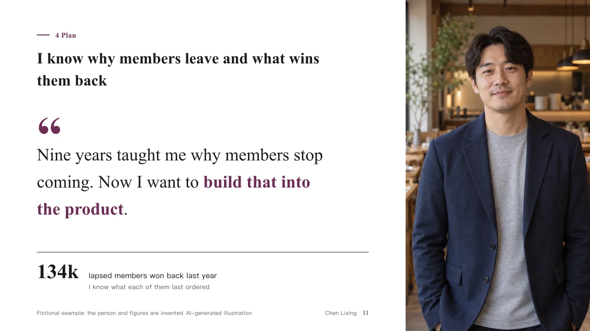
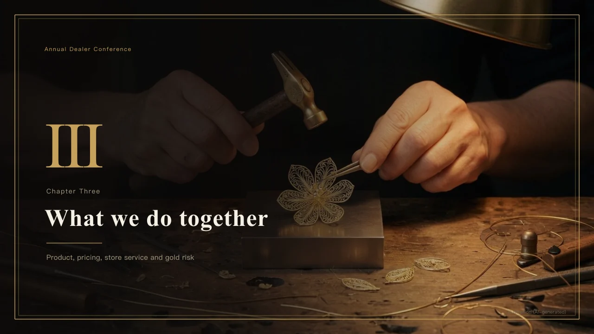
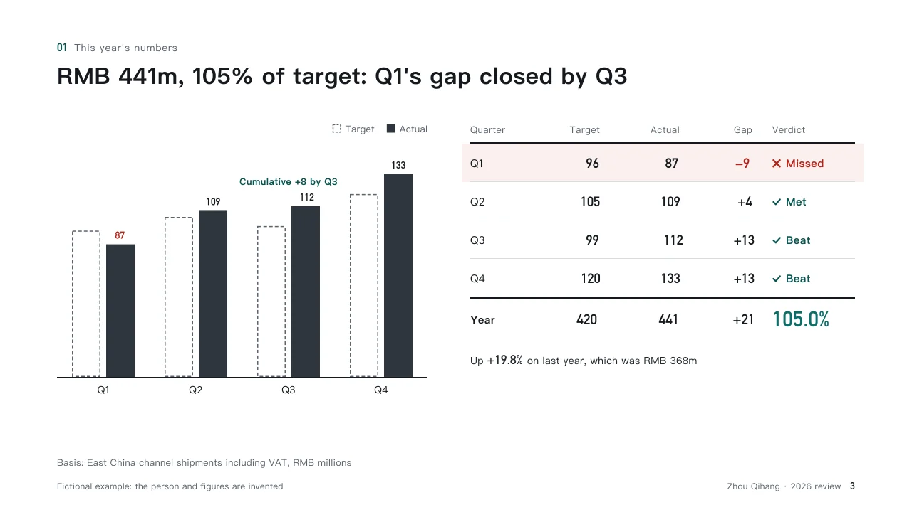
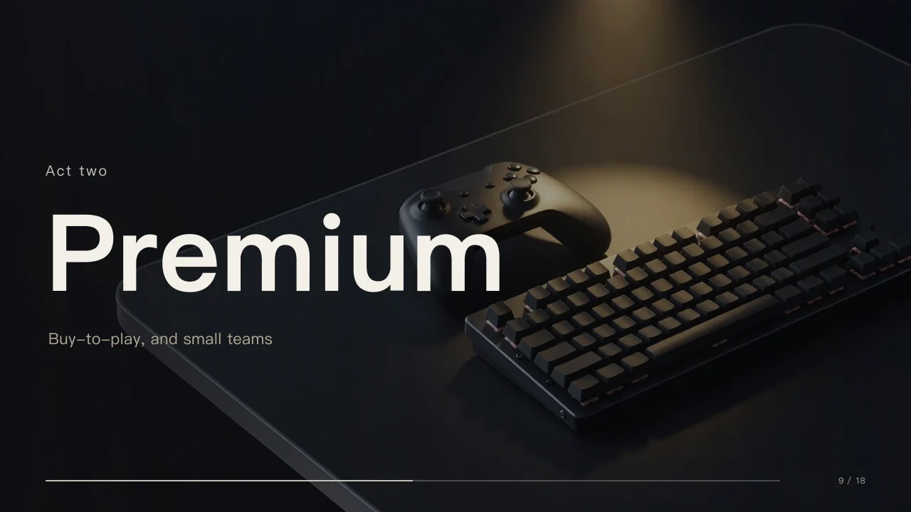
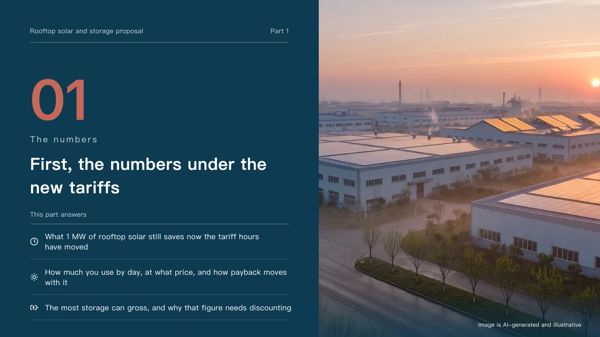
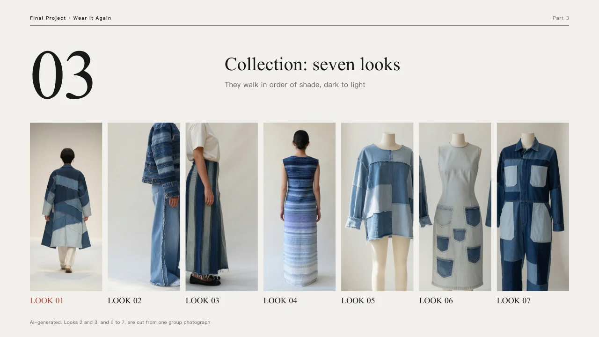
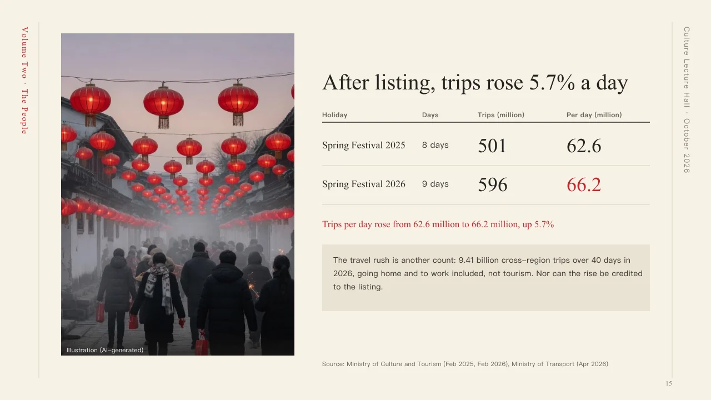

<p align="center"></p>

<h1 align="center">PPTwise</h1>

<p align="center"><b>A real PowerPoint, not HTML.</b></p>

<p align="center">🥇 <b>The most powerful deck-generation plugin for DeepSeek Harness (dsh)</b> 🥇</p>

<p align="center">
  <a href="https://pptwise.com">pptwise.com</a> ·
  <a href="./README.zh-CN.md">简体中文</a> ·
  <a href="./INSTALL.md">Install (hand it to your AI)</a> ·
  <a href="./docs/cli.md">Commands</a> ·
  <a href="./docs/ir.md">IR</a> ·
  <a href="./docs/themes.md">Themes</a> ·
  <a href="./skills/pptwise/SKILL.md">Agent skill</a> ·
  <a href="https://github.com/liustack/modlens">ModLens (vision)</a>
</p>

<p align="center">
  <a href="https://x.com/liustack"></a>
  <a href="https://www.npmjs.com/package/@liustack/pptwise"></a>
  <a href="https://nodejs.org"></a>
  <a href="LICENSE"></a>
  
  
</p>

## What it makes

<p align="center"><a href="https://pptwise.com/#samples"></a></p>

<table>
  <tr><td><a href="https://pptwise.com/samples/profile-member"></a><br><sub>Internal job application · profile</sub></td><td><a href="https://pptwise.com/samples/luxe-gold"></a><br><sub>Dealer conference · luxe</sub></td></tr>
  <tr><td><a href="https://pptwise.com/samples/recap-channel"></a><br><sub>Year-end review · recap</sub></td><td><a href="https://pptwise.com/samples/stage-game"></a><br><sub>Conference keynote · stage</sub></td></tr>
  <tr><td><a href="https://pptwise.com/samples/proposal-solar"></a><br><sub>Client proposal · proposal</sub></td><td><a href="https://pptwise.com/samples/rally-concert"></a><br><sub>Marketing plan · rally</sub></td></tr>
  <tr><td><a href="https://pptwise.com/samples/runway-denim"></a><br><sub>Graduation collection · runway</sub></td><td><a href="https://pptwise.com/samples/ink-ich"></a><br><sub>Public lecture · ink</sub></td></tr>
</table>

One page from the sample deck of each of the 24 themes, then eight up close, all rendered by the engine. Every sample pages through in full on [pptwise.com](https://pptwise.com/#samples), with its .pptx to download. In the exported file every heading, chart bar, label, and card is a native PowerPoint shape with editable text.

## Talk to us

Issues are welcome any time. [Open one](https://github.com/liustack/pptwise/issues/new/choose), or follow **[@liustack](https://x.com/liustack)** on X. Share what you made with PPTwise, which harness you use, and what the next release should solve. New releases land there first.

## Highlights

**⚡ Tell your AI what to cover, get the deck.** You bring the intent, the engine turns semantic page kinds and typed components into a coherent theme-bound deck. The same bound input renders the same output every time.

**✏️ Open it in PowerPoint and keep working.** Every heading, bullet, and chart bar opens in PowerPoint for you to retype and restyle. Chart and table figures are the exception: every bar and cell is an editable shape with editable text, not a native PowerPoint chart or table object carrying data, so to change the numbers, have your AI rebuild that page. Start from 24 factory themes, copy one into your workspace, or extract colors and fonts from a deck your company already uses.

**🔌 Installs into the agent you already use.** One command puts PPTwise into DeepSeek Harness, Claude Code, or any agent that reads a skill folder (Codex and friends), and it knows how to build a deck the moment it lands.

**🔁 Revisions without describing everything again.** One command opens a live preview in your browser. Tell your AI what to change in plain words, and the page refreshes itself as each revision lands.

**🔒 No account, no API key to render, no network at render time.** Install it and it works. Node 22.19+ or Bun is all you need on the machine. Optional stock-photo search uses the user's own Pexels key.

## Install

**Step 1, hand it to your AI.** Send it this line:

> Install PPTwise following https://raw.githubusercontent.com/liustack/pptwise/main/INSTALL.md, then run the health check and tell me the result.

**On DeepSeek Harness, send this instead.** There PPTwise is a native plugin rather than a skill folder, so it has its own guide. You pick the line, not your agent: an agent cannot reliably tell which harness it is running in.

> Install PPTwise following https://raw.githubusercontent.com/liustack/pptwise/main/INSTALL-dsh.md, then run the health check and tell me the result.

**Adding it yourself in DeepSeek Harness Desktop?** Open **Plugins**, choose **Add plugin**, and enter the package name `@liustack/pptwise@0.48.0`, not the GitHub address. The GitHub source does not carry the built engine, so a plugin added from it installs but cannot make a deck.

There is no step 2. Your AI puts the skill folder where your harness reads it, and the skill brings its own version-pinned launcher, so there is no CLI to install by hand. PPTwise renders a PPTX entirely locally: no API key, no account, nothing to configure for render. Optional stock-photo search needs the user's own Pexels key. The only prerequisite is Node 22.19+ (or Bun).

## Quick start

IR v5 is one JSON file describing a complete bound deck. Every content page names its semantic `kind`. The theme menu turns that kind into a visual face.

```json
{
  "version": "5",
  "filename": "hello.pptx",
  "theme": { "id": "brief" },
  "slides": [
    {
      "type": "cover",
      "heading": "Hello pptwise",
      "subheading": "A first native deck"
    },
    {
      "type": "content",
      "kind": "points",
      "heading": "Why it works",
      "components": [
        {
          "type": "bullets",
          "items": ["Semantic IR in", "Theme-menu lookup", "Native DrawingML out"]
        }
      ]
    },
    { "type": "ending", "heading": "Thanks" }
  ]
}
```

Save that as `deck.json`, then run:

```bash
pptwise validate deck.json
pptwise render deck.json -o out/hello.pptx
pptwise preview deck.json -o out/review --html
```

Choose a theme from `pptwise themes --json` by matching `occasions` and `identity`. Compare two to four candidates before binding:

```bash
pptwise theme try brief,swiss,memo
```

Create a complete independent v2 theme by copying a preset, forking a palette, or extracting an Office brand:

```bash
pptwise theme new --from brief -o themes/acme.theme.json --id acme
pptwise theme fork acme --primary "#0B5FFF" -o themes/acme-blue.theme.json --id acme-blue
pptwise brand extract corp.pptx -o themes/acme-brand.theme.json --id acme-brand --from brief
```

A deck project binds one theme in `deck.spec.json`, then keeps page content in `pages/<id>.json`. Render has no temporary theme switch. A same-menu color fork can replace the binding. A different menu requires returning to theme selection, then revisiting the spec and affected page fills.

No install also works: `npx -y @liustack/pptwise validate deck.json`. In a source checkout, use `node dist/cli.js` in place of `pptwise`. Ready-made v5 files live under `examples/`.

The commands you will reach for most:

| command | purpose |
| --- | --- |
| `spec validate <spec.json>` | Validate page order, kinds, headings, narrative, and theme-menu fit. |
| `assemble <dir>` | Combine a deck project into derived IR v5 without storing rendering choices. |
| `validate <target>` | Check IR, binding, menu, components, assets, and content quality. |
| `render <target> [-o <out.pptx>]` | Render native editable PPTX. |
| `audit <target>` | Check geometry, contrast, truncation, dropped content, and monotony. |
| `preview <target> [--html]` | Write SVG pages and an optional self-contained review file. |
| `serve <target>` | Start a live review that reloads on source changes. |
| `themes [--json]` | List factory themes with occasion and identity metadata. |
| `theme try <id,id,...>` | Compare the fixed sample across two to four themes. |
| `theme new`, `theme fork` | Copy a complete theme or create a full-palette fork. |
| `doctor` | Check runtime, skill copies, optional capabilities, and a self-test render. |

Full reference: [`docs/cli.md`](./docs/cli.md).

## Pictures and brand

An agent following the [skill](./skills/pptwise/SKILL.md) starts from your own material: `pptwise brand scan` finds the project's logo, pictures and brand colors, and the theme wall then offers a theme repainted in those colors. Pictures come next from stock search, which works with no setup, then from the web under a license that lets a deck use them, then from a local generator only you can turn on. Keys and generators: [Image sources and generators](./docs/cli.md#image-sources-and-generators). License rules: [pictures reference](./skills/pptwise/references/images.md).

## Documentation

| Doc | Read it when |
| :-- | :-- |
| [Install guide](./INSTALL.md) | Handing installation to an agent or checking prerequisites |
| [Agent skill](./skills/pptwise/SKILL.md) | Learning the workflow PPTwise teaches an agent |
| [CLI manual](./docs/cli.md) | Looking up commands, flags, audits, previews, and health checks |
| [IR reference](./docs/ir.md) | Writing IR v5 pages, kinds, components, assets, and narrative in JSON |
| [Themes](./docs/themes.md) | Copying, comparing, forking, binding, or authoring a complete v2 theme |
| [Core concepts](./docs/concepts.md) | Understanding theme, spec, component, kind, menus, and capacity |
| [Architecture](./docs/architecture.md) | Working on the menu route, render chain, or export boundary |
| [Deck projects](./docs/deck-projects.md) | Building a multi-file deck with a bound theme, locked spec, assets, and live review |
| [Menu lookup](./docs/menu-lookup.md) | Tracing how a page kind reaches one theme face across validation and render |
| [Contrast system](./docs/contrast-system.md) | Debugging text color, painted backgrounds, or contrast findings |
| [Designing themes](./docs/designing-themes.md) | Drawing a theme redesign that can actually compile to PPTX |
| [Design brief](./docs/design-brief.md) | The rules a design tool gets before it draws a face or component |
| [Reusable parts](./docs/reusable-parts.md) | Starting a theme from the compositions, fields and fixes earlier theme samples settled |
| [Testing](./docs/testing.md) | Running the right gate, inspecting snapshots, or changing exported XML |
| [Internal API](./docs/internal-api.md) | Understanding why the JavaScript internals carry no semver promise |
| [Release guide](./docs/releasing.md) | Preparing and publishing an npm release |
| [CHANGELOG](./CHANGELOG.md) | Finding what changed in a version |

## Credits

PPTwise is an open-source project by [liustack](https://liustack.dev).

Icon primitives are extracted from [lucide](https://lucide.dev) (ISC License). PPTwise itself was extracted from a production AI-deck-generation system and CJK-typography-tuned (full-width punctuation width, Chinese line breaking, a Chinese-first font stack, explicit east-asian font-slot declarations) from day one.

## License

[MIT](./LICENSE)
