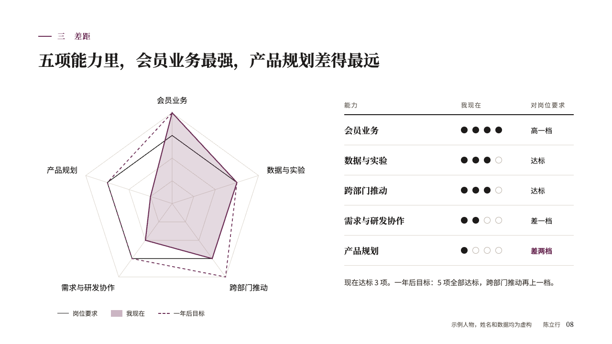
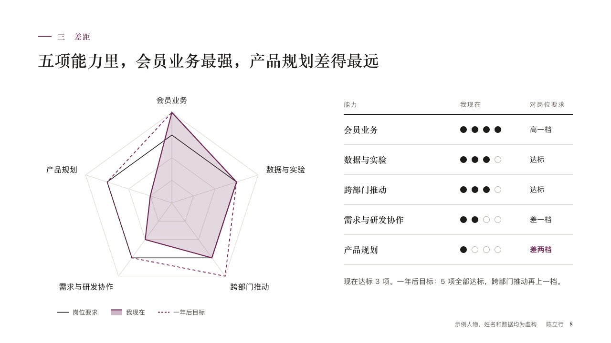

# appraisal

A self-assessment against what a role asks, as a radar beside a table of dots.

Code: [`src/layouts/compositions/appraisal.tsx`](../../../src/layouts/compositions/appraisal.tsx). The header comment there is the contract. The portrait setting only.

## profile, membership product manager candidacy sample, 2026-10

Settled on p08. The round's decisions are in [rounds/2026-10-12-profile](../../rounds/2026-10-12-profile/README.md).

| board (p08) | engine |
| :-: | :-: |
|  |  |

**What it looks like.** At the left a radar of the criteria: the role's line in the ink, the speaker now filled with the accent at 18% inside a line of the accent, a target dashed in the accent, a key under it, the footer row packed to the right. At the right an open table, a row a criterion: its name bold in the serif, the speaker's level as four dots, and the verdict against the role worked out in levels (「高一档」, 「达标」, 「差一档」), the furthest short bold in the accent. The page's paragraph under the table.

**Why.** A candidate who scores themselves honestly earns the panel's trust for the figures that follow. The radar shows the shape at a glance, the table says it in words.

**What it gave up.**

- Takes a `harvey_balls` of three to five criteria and two or three options, one highlighted and not the first, and optionally a `paragraph`.
- Scores are read as levels, a quarter a level, so a score between quarters is drawn at the level under it.
- A total, a criterion name too wide for its side of the radar or a paragraph past four lines sends the page back.
