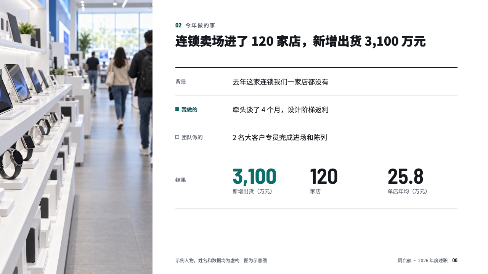
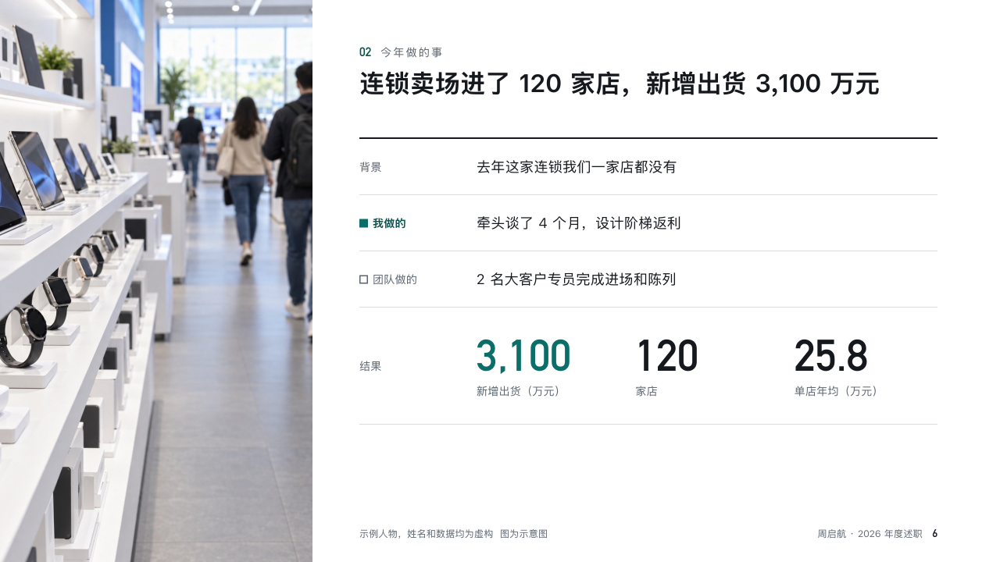

# casefile

A piece of work beside a photograph, closing on its results.

Code: [`src/layouts/compositions/casefile.tsx`](../../../src/layouts/compositions/casefile.tsx). The header comment there is the contract. The account setting only.

## recap, channel sales year-end review sample, 2026-10

Settled on p06. The round's decisions are in [rounds/2026-10-13-recap](../../rounds/2026-10-13-recap/README.md).

| board (p06) | engine |
| :-: | :-: |
|  |  |

**What it looks like.** A photograph bled from the left edge to x460. Beside it the case as rows under a 2px rule: what it was before, what the speaker did (the legend's filled square, 「我」), what the team did (an empty square), each with its words. A last row labelled 「结果」 sets the result figures in a row, the first in the accent.

**Why.** A review page about one piece of work has to say what the speaker did, not what happened near them.

**What it gave up.**

- Takes an `image`, a `row_cards` of two to four and a `kpi_cards` of two to four.
- The photograph's credit goes in the footer row after the deck's label.
