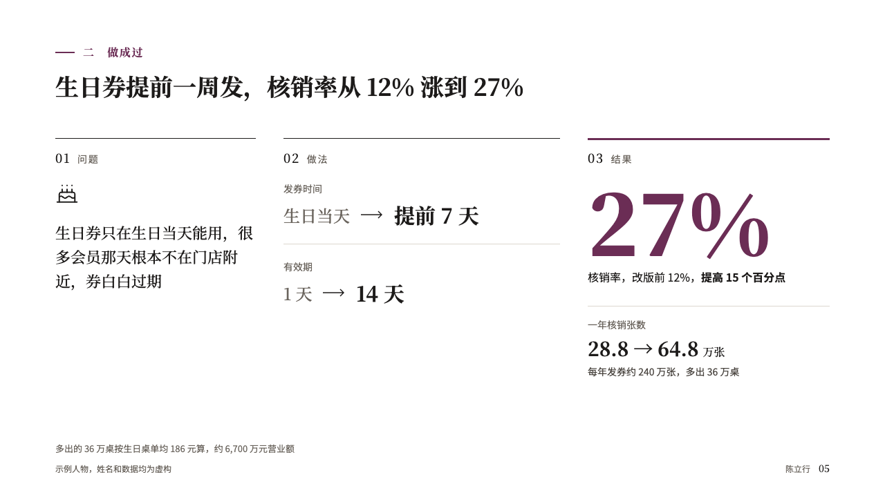
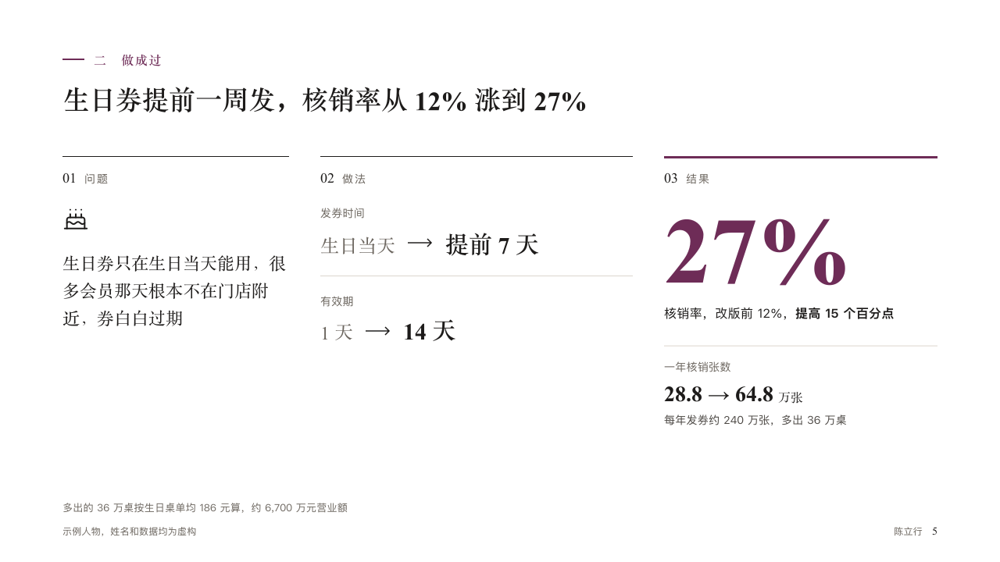

# casework

One piece of work told as a case: the problem, what was changed, and the result.

Code: [`src/layouts/compositions/casework.tsx`](../../../src/layouts/compositions/casework.tsx). The header comment there is the contract. The portrait setting only.

## profile, membership product manager candidacy sample, 2026-10

Settled on p05. The round's decisions are in [rounds/2026-10-12-profile](../../rounds/2026-10-12-profile/README.md).

| board (p05) | engine |
| :-: | :-: |
|  |  |

**What it looks like.** Three columns under the section line and the claim, each headed by its number in the serif and a small grey word tracked wide. 「问题」: the callout's icon and its words in the serif at 22px. 「做法」: each row that changed without a measured result, its label small and grey, the old value in grey, an arrow and the new value bold. 「结果」, under a 3px rule of the accent: the marked row's figure bold at 120px in the accent, a line naming it and where it started (「核销率，改版前 12%」), its change, and under a hairline any other row that moved.

**Why.** A panel trusts a result they can follow from its cause. The case reads left to right in the order the work was done.

**What it gave up.**

- Takes a `callout` with a title and a `from_to` with a label column, one marked row, one to three rows without a change and at most two others with one.
- A state's kicker, a span, a row's icon or tag, or a value too wide for its column sends the page back.
