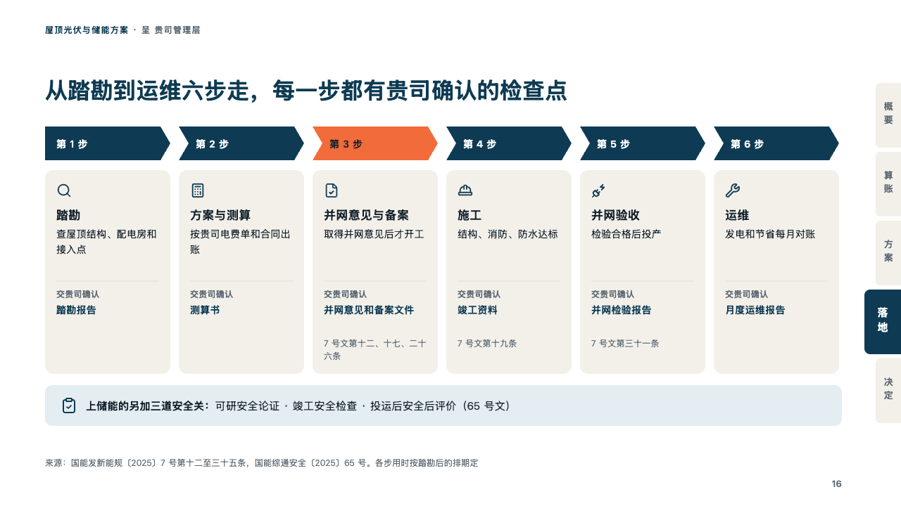
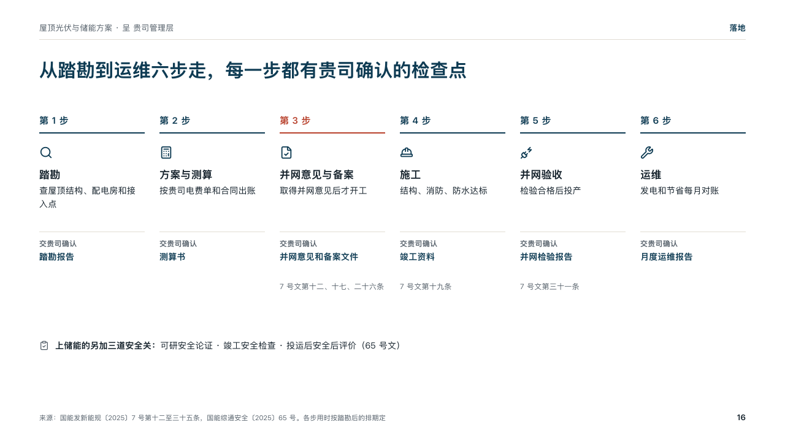

# checkpoints

How a project runs step by step, each step closed by a paper the client signs off.

Code: [`src/layouts/compositions/checkpoints.tsx`](../../../src/layouts/compositions/checkpoints.tsx). The header comment there is the contract. The binder setting only.

## proposal, rooftop solar and storage proposal sample, 2026-10

Settled on the roadmap page (p16). The round's decisions are in [rounds/2026-10-06-proposal](../../rounds/2026-10-06-proposal/README.md).

| board (p16) | engine |
| :-: | :-: |
|  |  |

The board in the table is the first round's. The print round set this page by the redrawn board's rules, and the engine render shows the page as it is set now.

**What it looks like.** A column a step, side by side: the step's date bold in petrol (「第 1 步」) over a 2px petrol rule, the step the page dwells on with its date and rule in the brick red. Under the rule: the step's icon in petrol, its name bold, what is done, a hairline, then what the paper is for in small grey (「交贵司确认」) over the paper bold in petrol, and the rule the step rests on in small grey. Under the columns, the note as one line after its grey icon, its title bold before its text.

**Why.** A client signs off a proposal more easily when every step ends in a paper they hold. The columns say the order, and each says what its step hands over.

**What it gave up.**

- Takes a horizontal `timeline` of three to six milestones, each with an icon and a text written "what is done。label：the paper", no tag, tone or lane, at most one highlighted, then optionally a `callout` with no tag. The full stop and the colon are declared, not printed.
- A name may run to two lines. A date past its column, a text past three lines, a paper or rule past two, a column whose words run past its foot, or a note past one line sends the page back.
