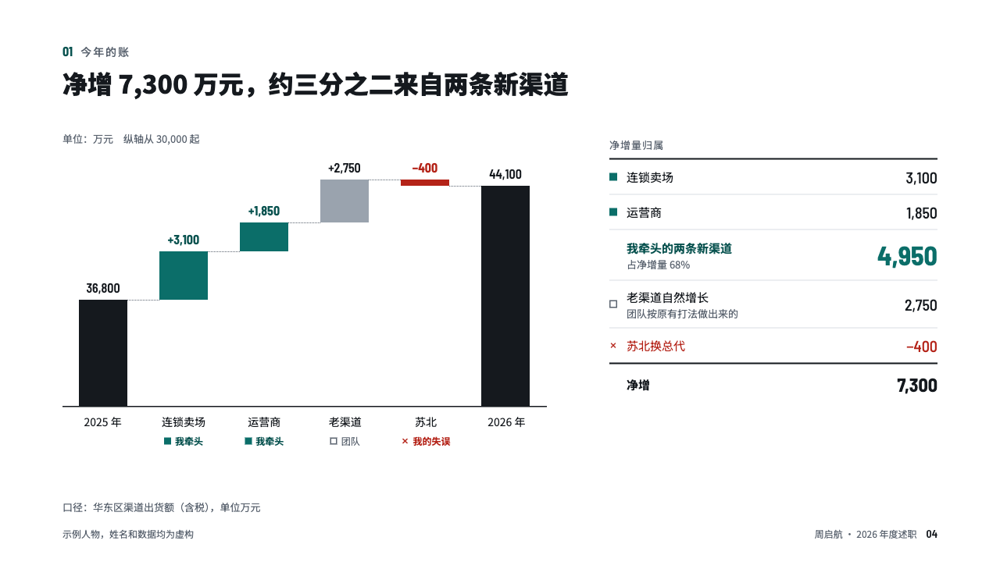
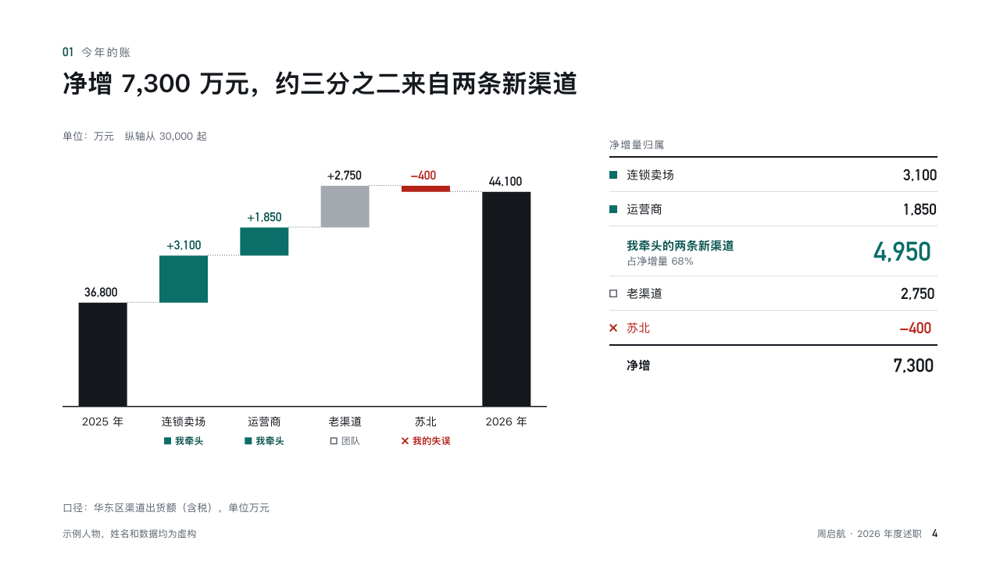

# credit

Where the year's growth came from, and whose it was.

Code: [`src/layouts/compositions/credit.tsx`](../../../src/layouts/compositions/credit.tsx). The header comment there is the contract. The account setting only.

## recap, channel sales year-end review sample, 2026-10

Settled on p04. The round's decisions are in [rounds/2026-10-13-recap](../../rounds/2026-10-13-recap/README.md).

| board (p04) | engine |
| :-: | :-: |
|  |  |

**What it looks like.** A bridge from last year's total to this year's on an axis that starts on a round number, the unit and the floor named over it. Each step carries its signed figure and under its label a legend mark: the speaker's steps in the accent, the team's in grey, a mistake as a red bar. At the right a ledger: the speaker's steps, their subtotal with its share of the net change (「占净增量 68%」), the rest, and the net change under a 2px rule.

**Why.** A reviewer wants the growth split by who made it. The bridge shows the sizes and the ledger adds the speaker's part up so nobody has to.

**What it gave up.**

- Takes a `waterfall` with a total at each end, a note on each step and its title and emphasis label.
- The ledger lists bar labels without the board's sublines.
