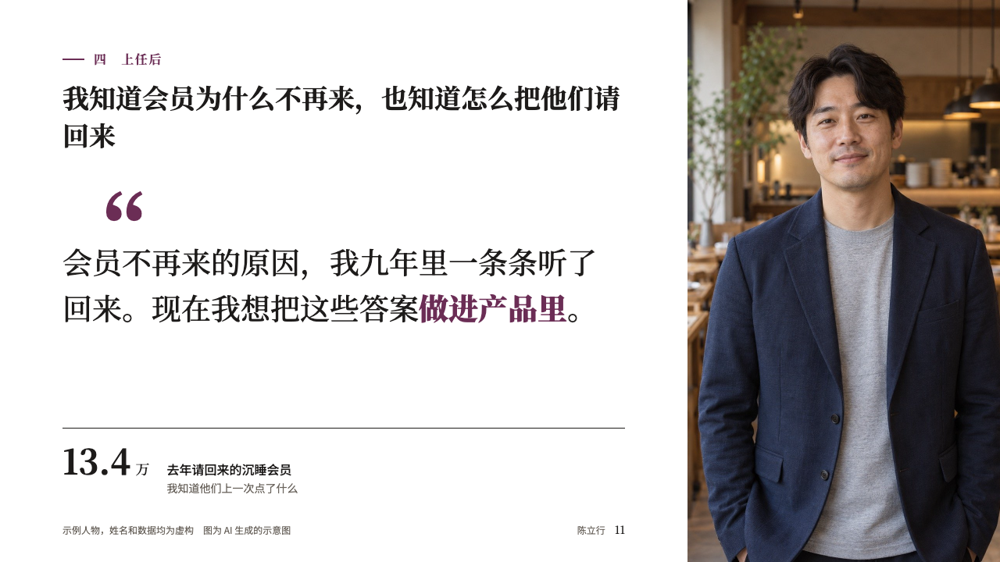
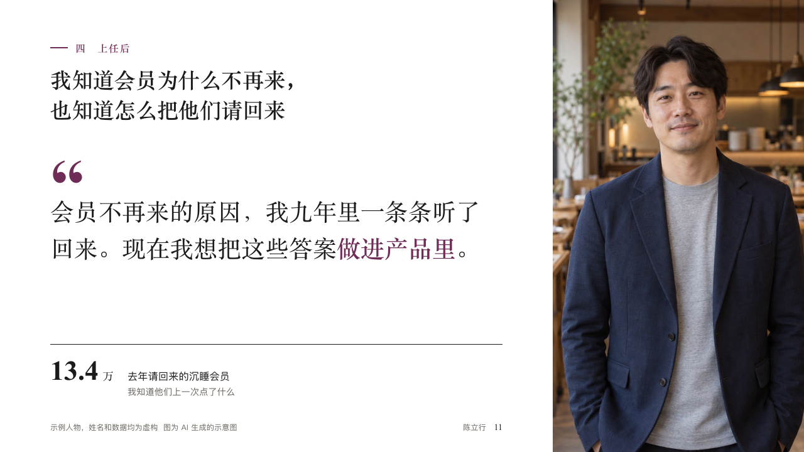

# credo

Why this person, in one sentence in their own words beside their portrait.

Code: [`src/layouts/compositions/credo.tsx`](../../../src/layouts/compositions/credo.tsx). The header comment there is the contract. The portrait setting only.

## profile, membership product manager candidacy sample, 2026-10

Settled on p11. The round's decisions are in [rounds/2026-10-12-profile](../../rounds/2026-10-12-profile/README.md).

| board (p11) | engine |
| :-: | :-: |
|  |  |

**What it looks like.** The portrait bleeds from x880 to the right edge. In the column at the left: the section line, the claim, an opening quotation mark set huge in the serif in the accent, the paragraph under it in the serif at 38px with its marked words bold in the accent, and under a hairline of the ink the one figure it rests on, its label beside it on its baseline and its note under the label. The footer row keeps to the column.

**Why.** The last content page is what the panel takes into its discussion. One sentence in the speaker's voice, with the figure that backs it, is easier to repeat than a summary.

**What it gave up.**

- Takes an `image`, a `paragraph` and a `kpi_cards` of one, in any order.
- A caption, an item with an icon, delta, tag, tone or source, a paragraph past four lines or a claim past two lines sends the page back.
