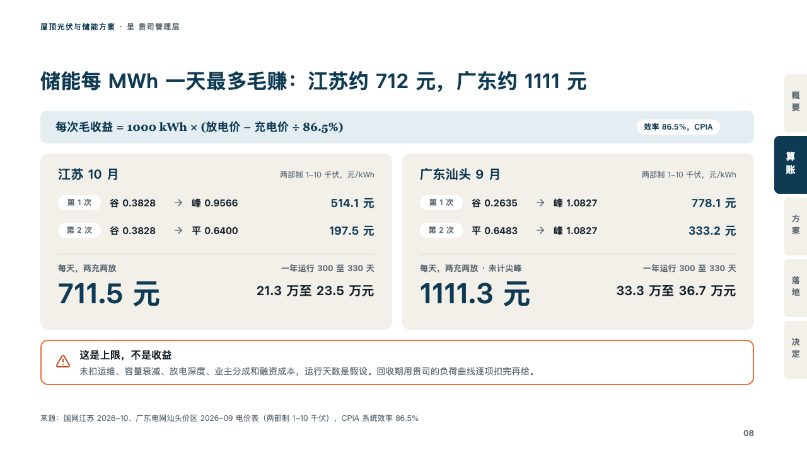
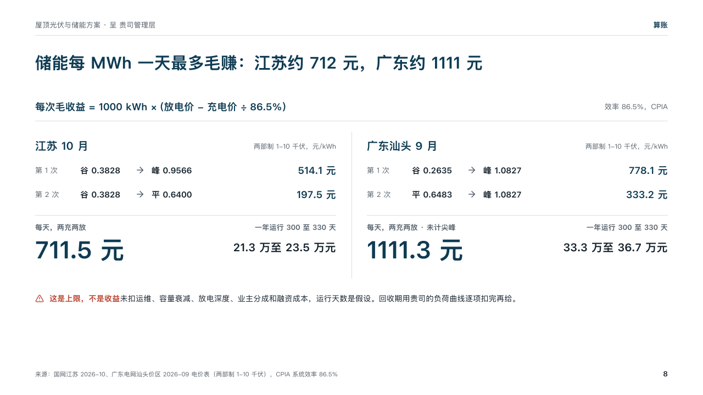

# cycles

What a store of energy earns a day, worked out place by place.

Code: [`src/layouts/compositions/cycles.tsx`](../../../src/layouts/compositions/cycles.tsx). The header comment there is the contract. The binder setting only.

## proposal, rooftop solar and storage proposal sample, 2026-10

Settled on the storage sum page (p08). The round's decisions are in [rounds/2026-10-06-proposal](../../rounds/2026-10-06-proposal/README.md).

| board (p08) | engine |
| :-: | :-: |
|  |  |

The board in the table is the first round's. The print round set this page by the redrawn board's rules, and the engine render shows the page as it is set now.

**What it looks like.** Over the columns the formula bold in petrol with what it rests on in small grey at the right, a hairline under both. A column a place, parted by a hairline: its name at 20px in petrol, the unit at its right in small grey, then a line a cycle (the cycle's name in small grey, what it buys at and sells at with an arrow between, what it earns at the right in petrol), a hairline, the day's figure at 44px in petrol with its label and note in small grey, and at the right the year's range bold. Under the columns, the warning as a line: its icon and its title in the brick red, the one thing the page lights, and its text after them.

**Why.** A battery's case is two trades a day. Writing each trade out, then the day and the year, shows the figure is a ceiling the proposal does not count as income.

**What it gave up.**

- Takes a `callout` with no title and a tag (the formula), a `comparison` of two columns with a title, whose rows are one to three cycles written "buy → sell：earns", the marked row and one labelled row, then a `callout` with a title and no tag.
- The arrow is drawn and the colon declared, not printed.
- A formula and its source past the line, a name, cycle, figure or range past its column, or a warning past two lines sends the page back.
