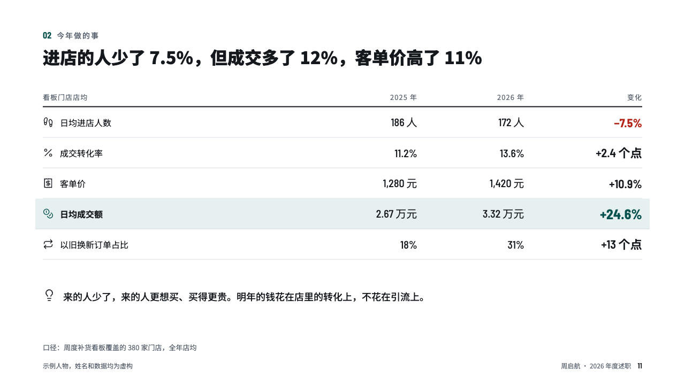

# deltas

Before, after and the change, a row a measure.

Code: [`src/layouts/compositions/deltas.tsx`](../../../src/layouts/compositions/deltas.tsx). The header comment there is the contract. The account setting only.

## recap, channel sales year-end review sample, 2026-10

Settled on p11. The round's decisions are in [rounds/2026-10-13-recap](../../rounds/2026-10-13-recap/README.md).

| board (p11) | engine |
| :-: | :-: |
|  |  |

**What it looks like.** An open table under a 2px rule: an icon and the measure, last year, this year and the change, every column after the first right-aligned. A falling change in red, the row the page is about on the accent's tint with its change in the accent. A closing line with an icon under the table.

**Why.** When the story is in the ratios, a plain table with the change spelled out is the honest page.

**What it gave up.**

- Takes a `data_table` of three to five columns and a `callout` with an optional icon.
