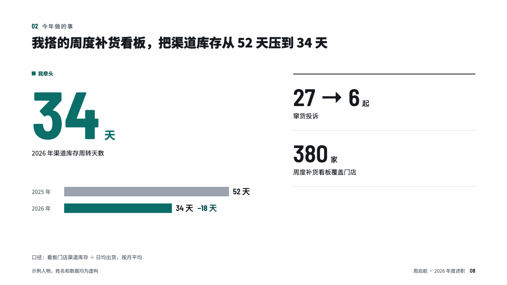
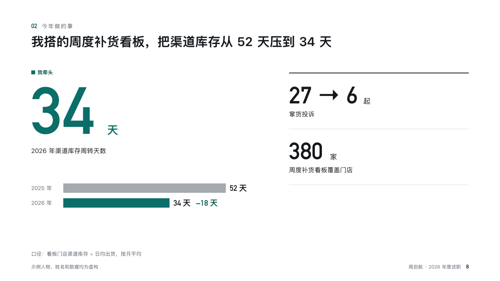

# drawdown

One figure moved, with its before and after.

Code: [`src/layouts/compositions/drawdown.tsx`](../../../src/layouts/compositions/drawdown.tsx). The header comment there is the contract. The account setting only.

## recap, channel sales year-end review sample, 2026-10

Settled on p08. The round's decisions are in [rounds/2026-10-13-recap](../../rounds/2026-10-13-recap/README.md).

| board (p08) | engine |
| :-: | :-: |
|  |  |

**What it looks like.** At the left one figure at 168px in the accent with its unit and label, and under it two bars on their side for before and after with their figures and the change. At the right a column of side figures under hairlines.

**Why.** Some years come down to one number that moved. Making it the biggest thing on the page says so.

**What it gave up.**

- Takes a one-series `bar` chart of two or three points, one of them marked, and a `kpi_cards` of three or four, the first being the hero.
