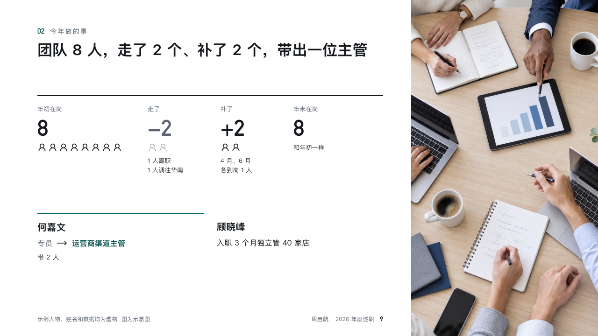

# headcount

The team's year in counts and people.

Code: [`src/layouts/compositions/headcount.tsx`](../../../src/layouts/compositions/headcount.tsx). The header comment there is the contract. The account setting only.

## recap, channel sales year-end review sample, 2026-10

Settled on p09. The round's decisions are in [rounds/2026-10-13-recap](../../rounds/2026-10-13-recap/README.md).

| board (p09) | engine |
| :-: | :-: |
|  |  |

**What it looks like.** Four counts across the top (in January, left, joined, at year end), each with a row of person marks, dashed for those who left. Under a rule the people worth naming, a moved role drawn as from, an arrow, to, under a 3px rule of the accent. A photograph bled off the right.

**Why.** Reviewers ask whether the team got stronger. Counts and two names answer it faster than an org chart.

**What it gave up.**

- Takes an `image`, a `kpi_cards` of four and a `people_cards`.
