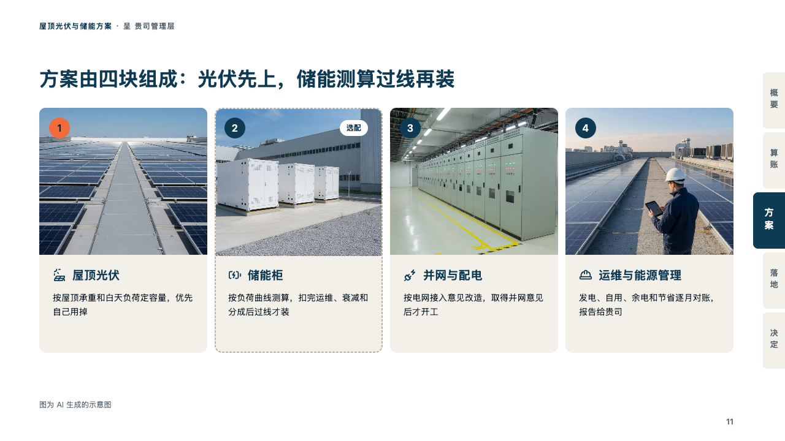
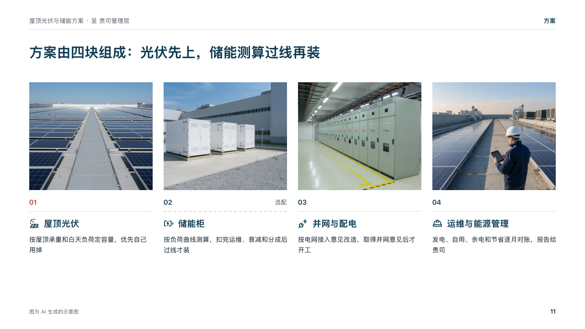

# parts

What a solution is made of, a photograph and a column a part.

Code: [`src/layouts/compositions/parts.tsx`](../../../src/layouts/compositions/parts.tsx). The header comment there is the contract. The binder setting only.

## proposal, rooftop solar and storage proposal sample, 2026-10

Settled on the solution page (p11). The round's decisions are in [rounds/2026-10-06-proposal](../../rounds/2026-10-06-proposal/README.md).

| board (p11) | engine |
| :-: | :-: |
|  |  |

The board in the table is the first round's. The print round set this page by the redrawn board's rules, and the engine render shows the page as it is set now.

**What it looks like.** A column a part, side by side: its photograph across the column's top with square corners, then a line with its number in two digits bold in petrol (the first in the brick red when the grid leads with it) and its tag in small grey at the right, a hairline, then its icon and name in petrol and a few lines on it. A part whose tag is not settled yet (a `basis` of estimate, pending or proposal, 「选配」) has that hairline dashed.

**Why.** A client buys parts they can picture. A photograph each, and the optional part marked by a dashed rule, says what is in the offer and what is not yet.

**What it gave up.**

- Takes an `image_grid` of two to four pictures, each with an icon and a caption written "name：what", tags allowed. The colon is declared, not printed.
- A name past one line, a text past three lines or a number and tag wider than their column sends the page back.
