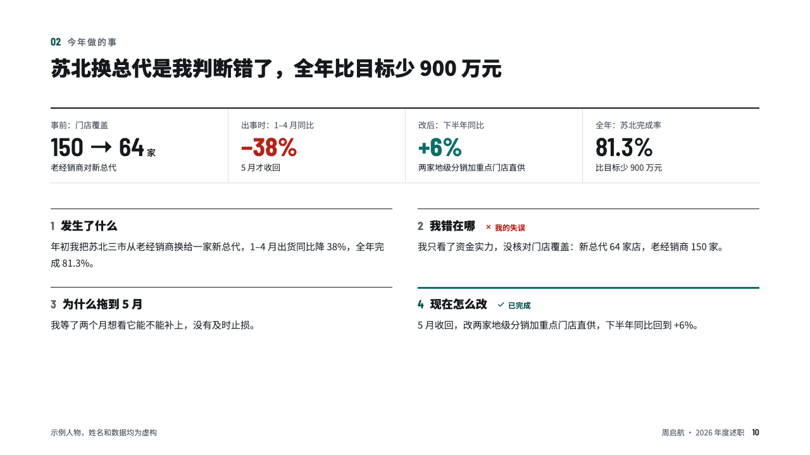
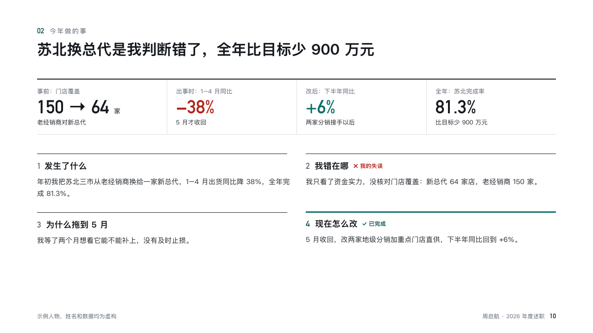

# postmortem

A miss told as four figures and four plain rows.

Code: [`src/layouts/compositions/postmortem.tsx`](../../../src/layouts/compositions/postmortem.tsx). The header comment there is the contract. The account setting only.

## recap, channel sales year-end review sample, 2026-10

Settled on p10. The round's decisions are in [rounds/2026-10-13-recap](../../rounds/2026-10-13-recap/README.md).

| board (p10) | engine |
| :-: | :-: |
|  |  |

**What it looks like.** Four figures across the top under a rule: before, when it went wrong, after the fix, the year. Under them four numbered rows in a 2×2 grid: what happened, where the speaker went wrong (a red cross, 「我的失误」), why it took so long, what changed (a tick, 「已完成」, under a rule of the accent).

**Why.** A review that hides the miss loses the room. This page names it in the speaker's own words and closes on the fix.

**What it gave up.**

- Takes a `kpi_cards` of four and a `row_cards` of four.
