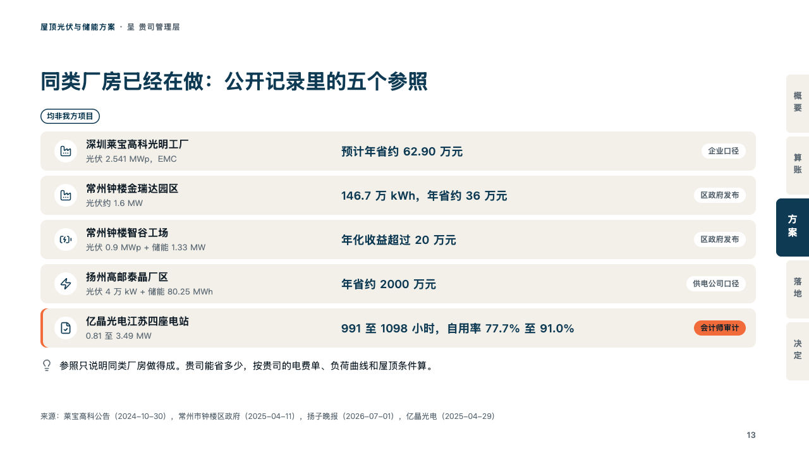
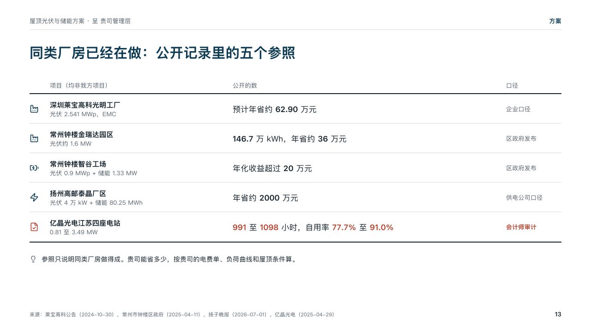

# precedents

Public records a client can check, a ruled row a record with the kind of source behind its figure.

Code: [`src/layouts/compositions/precedents.tsx`](../../../src/layouts/compositions/precedents.tsx). The header comment there is the contract. The binder setting only.

## proposal, rooftop solar and storage proposal sample, 2026-10

Settled on the public references page (p13). The round's decisions are in [rounds/2026-10-06-proposal](../../rounds/2026-10-06-proposal/README.md).

| board (p13) | engine |
| :-: | :-: |
|  |  |

The board in the table is the first round's. The print round redrew this page in a design tool outside this folder, and the engine render shows the page as it is set now.

**What it looks like.** A ruled table: the headers in small grey over a 2px rule of the ink (the table's title heads the name column when that column has no header of its own, 「项目（均非我方项目）」), a row a record under a hairline: its icon in petrol, its name bold over its scale in grey, its figure at 17px with its numbers bold, and the kind of source the figure is in small grey in a column of its own (the table's fourth column, 「口径」, or the row's tag). A 2px rule of the ink closes the table. The record the page leans on (a row marked `highlight`) has its icon, its numbers and its kind of source in bold brick red, on no ground of its own. Under the table, a line after a grey icon on what the records do not show.

**Why.** A supplier's own references are what a client trusts least. Public records, each with who reported the figure and said plainly not to be the supplier's own, are ones the client can look up.

**What it gave up.**

- Takes a `data_table` of three columns (the name, the scale, the figure), each row with a tag, or of four (the kind of source last), two to six rows each with an icon, at most one marked `highlight`, no total, and a title only when the name column has no header, then optionally a `callout` with no tag.
- A header, name, scale, figure or kind past its column, or a line past one line sends the page back.
