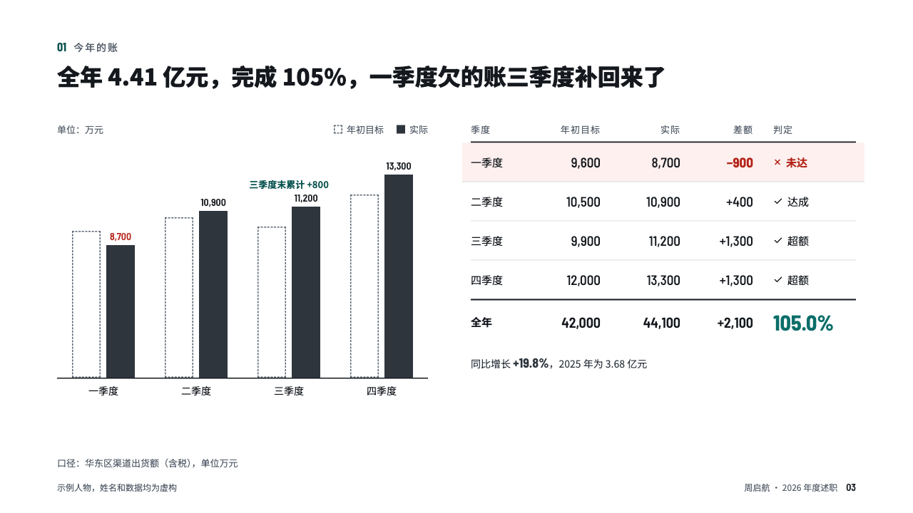
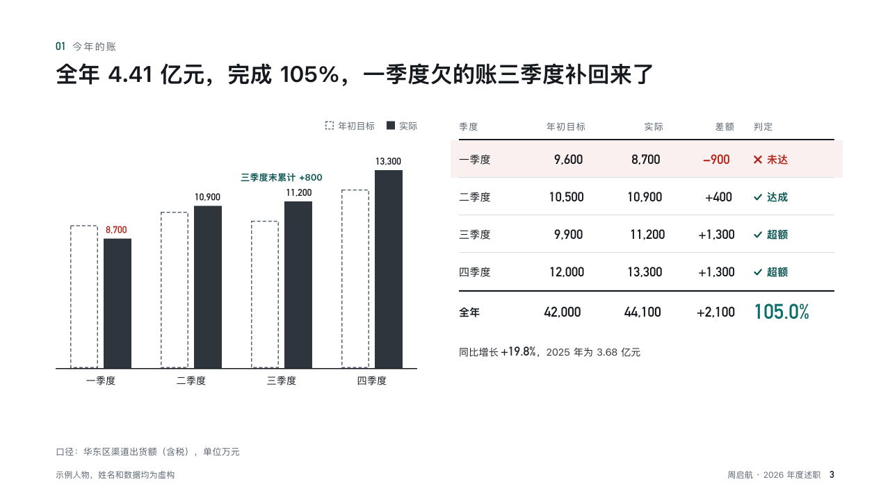

# reckoning

Target against actual, period by period, beside a ledger.

Code: [`src/layouts/compositions/reckoning.tsx`](../../../src/layouts/compositions/reckoning.tsx). The header comment there is the contract. The account setting only.

## recap, channel sales year-end review sample, 2026-10

Settled on p03. The round's decisions are in [rounds/2026-10-13-recap](../../rounds/2026-10-13-recap/README.md).

| board (p03) | engine |
| :-: | :-: |
|  |  |

**What it looks like.** At the left, a dashed box for each period's target and a graphite bar for what came in, the actual figure over it, a missed period's figure in red. Over the bars a line in the accent names the period the running gap closed in (「三季度累计 +800」). At the right a ledger: the period, target, actual, gap and a verdict word after a mark, the missed row on a red tint, a year row under a 2px rule with the year's rate in the accent, and the note under it with its signed figure bold.

**Why.** The first question in a review is whether the number held. Bars show the shape of the year and the ledger gives the exact figures the reviewer will quote.

**What it gave up.**

- Takes a `scorecard` of two to six periods whose targets and actuals are figures.
- The verdict words come from each row's status (「未达」, 「达成」, 「超额」), so the page cannot contradict the figures.
- The board's 「单位：万元」 line over the bars is not drawn: the source line under the page names the unit.
