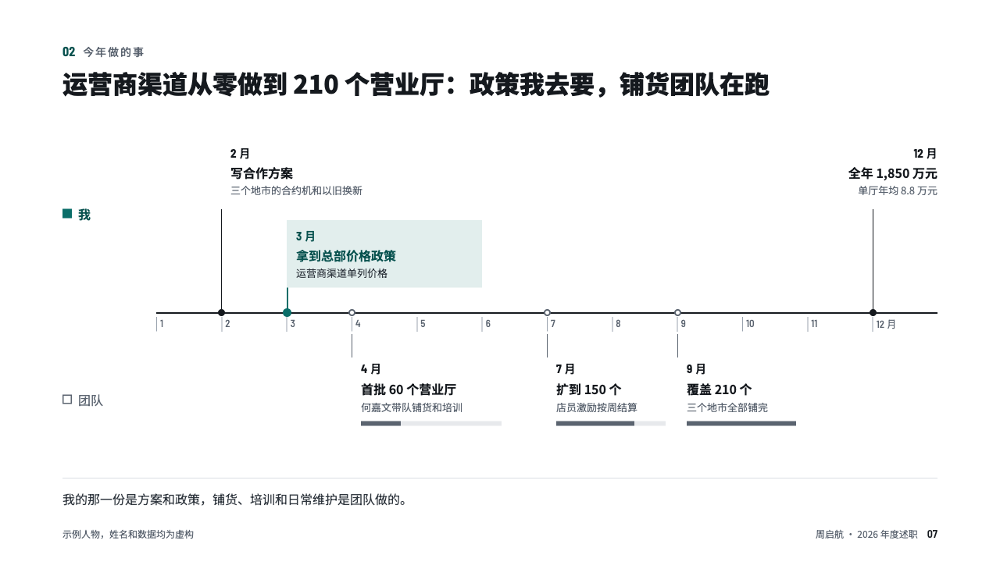
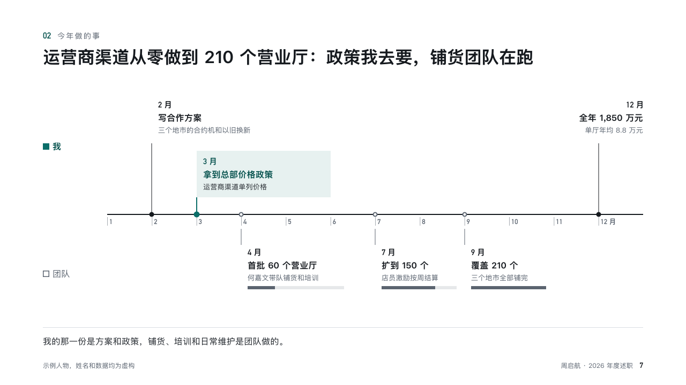

# relay

A year of the speaker's and the team's milestones on one axis.

Code: [`src/layouts/compositions/relay.tsx`](../../../src/layouts/compositions/relay.tsx). The header comment there is the contract. The account setting only.

## recap, channel sales year-end review sample, 2026-10

Settled on p07. The round's decisions are in [rounds/2026-10-13-recap](../../rounds/2026-10-13-recap/README.md).

| board (p07) | engine |
| :-: | :-: |
|  |  |

**What it looks like.** Months across the page on one axis at y400. The speaker's milestones stand above it, the team's hang below with a progress bar each that counts up to the last one. The milestone the speaker landed is washed in the accent's tint. A closing line under a hairline says who did which part.

**Why.** Work handed from one person to a team is easy to claim whole. Two lanes on one calendar show the hand-off without saying it.

**What it gave up.**

- Takes a `timeline` with two lanes whose dates are months and a `callout`.
- Milestones whose titles do not count up get no progress bars.
