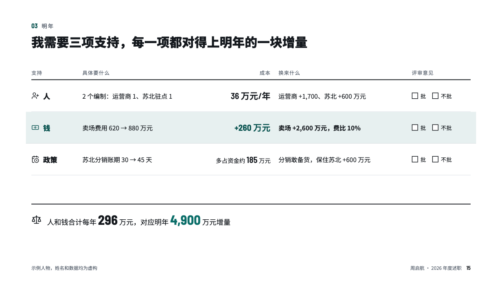
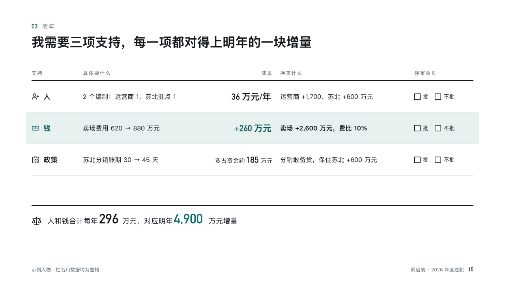

# requests

The asks, each with what it costs and what it buys, to tick.

Code: [`src/layouts/compositions/requests.tsx`](../../../src/layouts/compositions/requests.tsx). The header comment there is the contract. The account setting only.

## recap, channel sales year-end review sample, 2026-10

Settled on p15. The round's decisions are in [rounds/2026-10-13-recap](../../rounds/2026-10-13-recap/README.md).

| board (p15) | engine |
| :-: | :-: |
|  |  |

**What it looks like.** A table under a 2px rule: an icon and the ask, what exactly, the cost as a figure, what it buys, and an empty box for each choice of the page's ballot (「批」, 「不批」) in a derived 「评审意见」 column. The row the page is about on the accent's tint. A closing line under a rule sets the sum against the growth, its figures large.

**Why.** The point of a review is a decision. Boxes to tick turn the asks into one.

**What it gave up.**

- Takes a `data_table` of four columns, a `callout` and a `ballot` of two to four choices.
