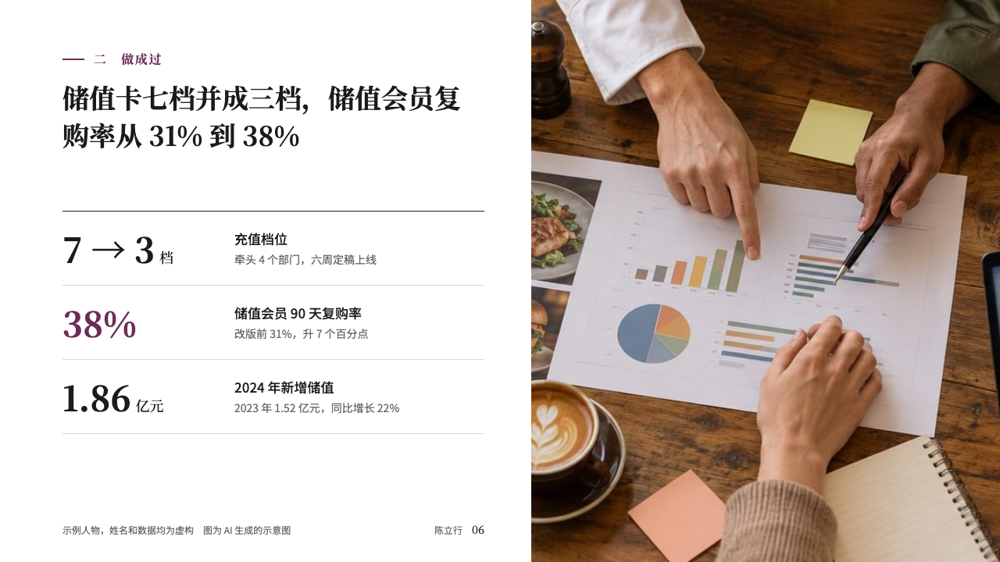
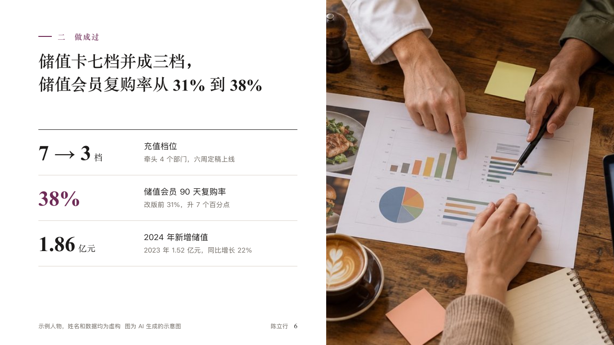

# results

What a piece of work came to, in a few figures beside a photograph of the work.

Code: [`src/layouts/compositions/results.tsx`](../../../src/layouts/compositions/results.tsx). The header comment there is the contract. The portrait setting only.

## profile, membership product manager candidacy sample, 2026-10

Settled on p06. The round's decisions are in [rounds/2026-10-12-profile](../../rounds/2026-10-12-profile/README.md).

| board (p06) | engine |
| :-: | :-: |
|  |  |

**What it looks like.** The photograph bleeds from x680 to the right edge. In the column at the left: the section line, the claim, and the figures as open rows, each bold in the serif at 44px with its unit, in the accent when the author marked all of it, its label at 17px and its note at 14px in the grey beside it. The footer row keeps to the column.

**Why.** Two or three figures are what a panel carries out of the room. Set large with nothing between them, they are read as results rather than as a table.

**What it gave up.**

- Takes an `image` and a `kpi_cards` of two to four with no icon, delta, tag, tone or source.
- A figure wider than its 200px, a label past one line or a note past two sends the page back.
