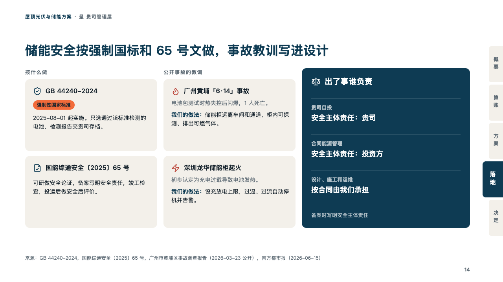
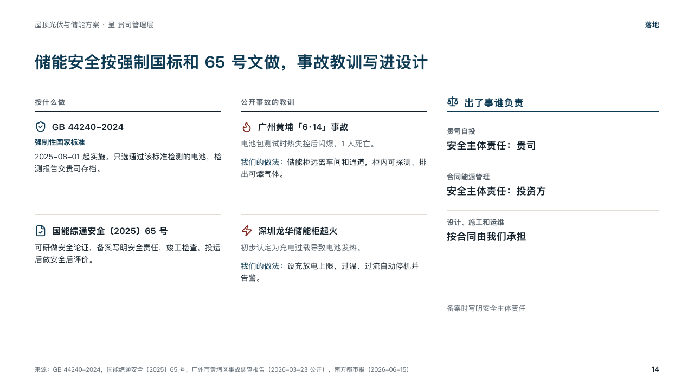

# safeguards

What a risk is held to, what went wrong before and who answers for it.

Code: [`src/layouts/compositions/safeguards.tsx`](../../../src/layouts/compositions/safeguards.tsx). The header comment there is the contract. The binder setting only.

## proposal, rooftop solar and storage proposal sample, 2026-10

Settled on the storage safety page (p14). The round's decisions are in [rounds/2026-10-06-proposal](../../rounds/2026-10-06-proposal/README.md).

| board (p14) | engine |
| :-: | :-: |
|  |  |

The board in the table is the first round's. The print round set this page by the redrawn board's rules, and the engine render shows the page as it is set now.

**What it looks like.** Three columns, each under its title in small tracked grey and a 2px ink rule. The first column's items, parted by a hairline, the rules: each rule's icon in petrol, its name bold, the tag that settles it in small bold petrol, what it asks. The second column's items, the lessons: each icon in the danger ink, its name bold, what happened in grey, then what is done about it with its lead in bold petrol (「我们的做法：」). At the right the panel as a third column: its icon and title in petrol over a 2px petrol rule, a row a party under a hairline (who in small grey over what they answer for, bold), its footnote at its foot.

**Why.** Storage safety is where a client's caution starts. The binding rule, the fires that already happened and the name of who is liable, side by side, answer it without reassurance.

**What it gave up.**

- Takes an `icon_cards` of two with a title, tags allowed only when settled, an `icon_cards` of two with a title whose cards are written "what happened。lead：what is done", and an `insight_panel` of two to four rows.
- A title past its column, an item's name past one line or its text past three, a lesson not written that way, or a panel row or footnote past its column sends the page back.
