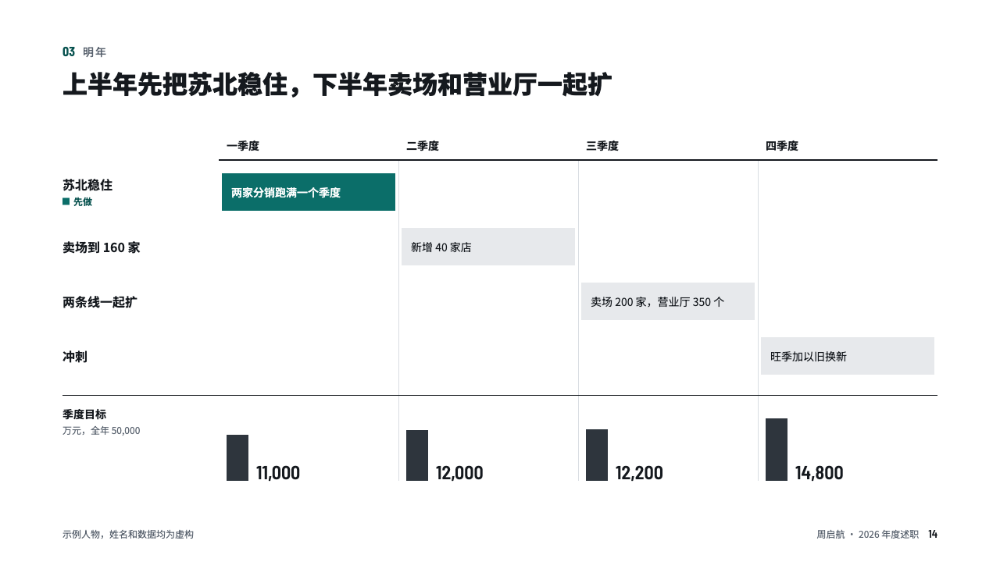
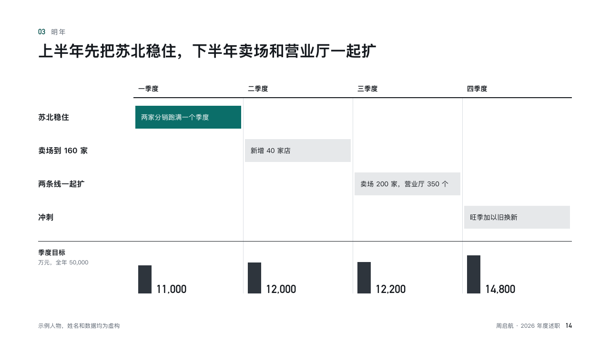

# sequence

The plan by quarter, and what each quarter must bring in.

Code: [`src/layouts/compositions/sequence.tsx`](../../../src/layouts/compositions/sequence.tsx). The header comment there is the contract. The account setting only.

## recap, channel sales year-end review sample, 2026-10

Settled on p14. The round's decisions are in [rounds/2026-10-13-recap](../../rounds/2026-10-13-recap/README.md).

| board (p14) | engine |
| :-: | :-: |
|  |  |

**What it looks like.** Periods across the top, each phase's work a bar stepping down the page across its period, the first filled with the accent, the rest pale. Under a hairline what each period has to bring in: small bars on one scale beside their figures, the unit and the year's sum at the left.

**Why.** Reviewers sign off on a plan they can check by quarter. The steps show the order, the bars show the load.

**What it gave up.**

- Takes a `roadmap` of two to four phases, each with a period, one point and one row whose value is a figure, all rows in one unit.
- The board's 「先做」 chip under the first phase's name is not drawn: the filled bar already says it.
