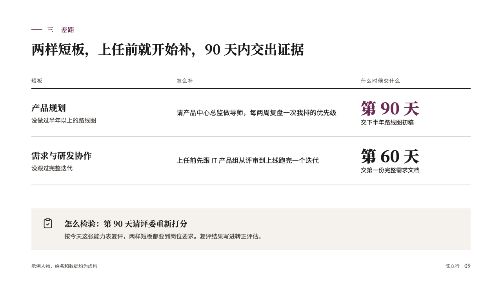
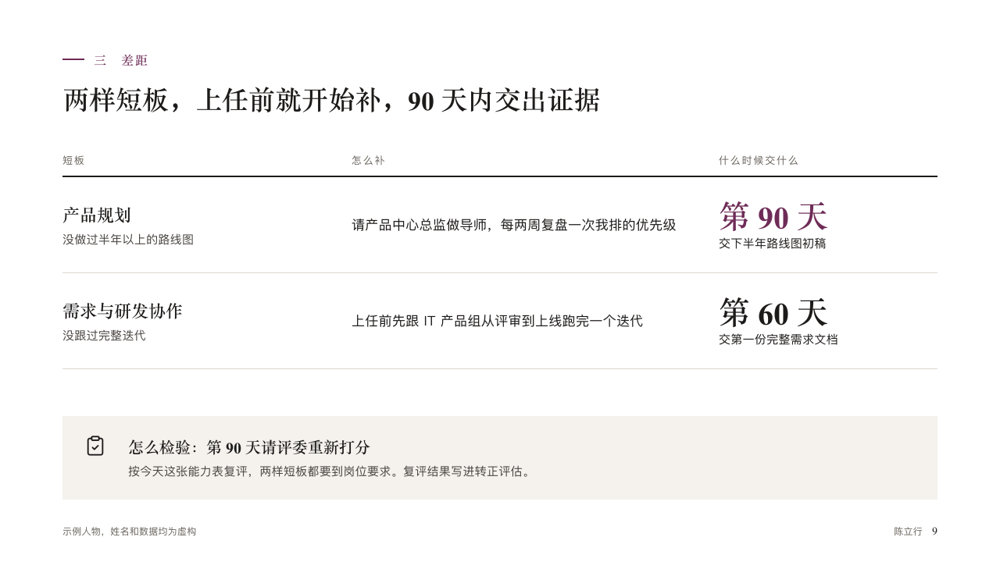

# shortfalls

The gaps the speaker names, how each will close and when the proof is due.

Code: [`src/layouts/compositions/shortfalls.tsx`](../../../src/layouts/compositions/shortfalls.tsx). The header comment there is the contract. The portrait setting only.

## profile, membership product manager candidacy sample, 2026-10

Settled on p09. The round's decisions are in [rounds/2026-10-12-profile](../../rounds/2026-10-12-profile/README.md).

| board (p09) | engine |
| :-: | :-: |
|  |  |

**What it looks like.** An open table across the measure: the gap's name up to its colon bold in the serif at 22px with what follows under it, how it closes at 17px, and when the proof is due set as a figure bold in the serif at 40px (「第 90 天」) with what is handed in under it. The marked row's figure is in the accent. Under the table the callout as the check that closes the page, on a band of the paper's warmth.

**Why.** Naming a gap with a date and a deliverable turns a weakness into a plan the panel can hold the speaker to.

**What it gave up.**

- Takes a `comparison` of two columns and two to four rows whose labels and last cells each break at a colon, and optionally a `callout` with a title.
- A table title, a recommended column, a row's icon or tag, or a figure wider than its column sends the page back.
