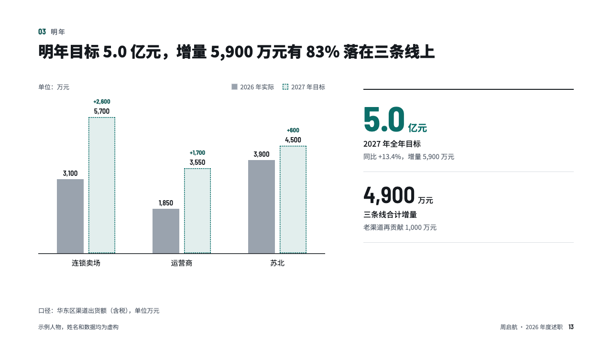
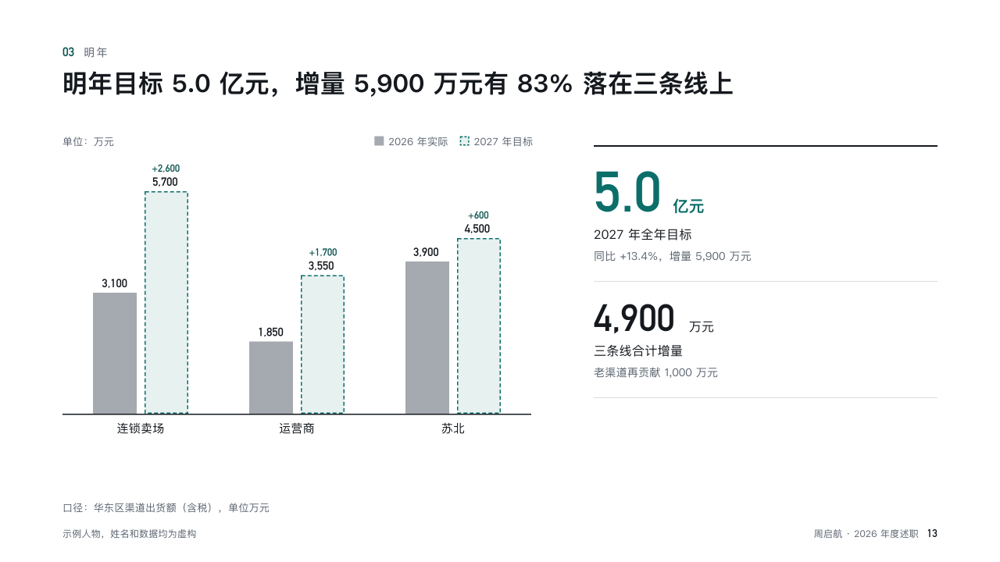

# stretch

This year's bars beside next year's targets.

Code: [`src/layouts/compositions/stretch.tsx`](../../../src/layouts/compositions/stretch.tsx). The header comment there is the contract. The account setting only.

## recap, channel sales year-end review sample, 2026-10

Settled on p13. The round's decisions are in [rounds/2026-10-13-recap](../../rounds/2026-10-13-recap/README.md).

| board (p13) | engine |
| :-: | :-: |
|  |  |

**What it looks like.** Pairs of bars: this year's in grey with its figure, next year's target as a dashed box on the accent's tint with its figure and the increase over it. Beside them the target at 64px in the accent and the growth, each with its label and note.

**Why.** A target is believable when it sits next to what was done. The dashed box says it is a promise, not a result.

**What it gave up.**

- Takes a two-series `bar` chart whose second series is all `status: "target"`, and a `kpi_cards` of two or three.
