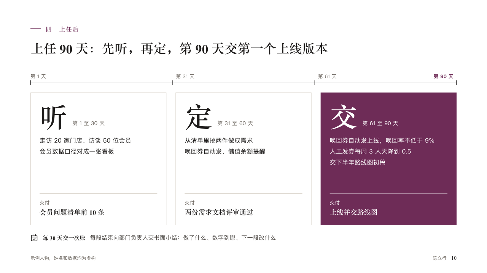

# tenure

The first days in a new post as phases on a ruler.

Code: [`src/layouts/compositions/tenure.tsx`](../../../src/layouts/compositions/tenure.tsx). The header comment there is the contract. The portrait setting only.

## profile, membership product manager candidacy sample, 2026-10

Settled on p10. The round's decisions are in [rounds/2026-10-12-profile](../../rounds/2026-10-12-profile/README.md).

| board (p10) | engine |
| :-: | :-: |
|  |  |

**What it looks like.** A ruler across the measure with a tick where each phase starts and at its end, each start named in the grey (「第 31 天」) and the last day bold in the accent. Under it the phases as equal blocks in pale outlines: the title set huge in the serif (「听」, 「定」, 「交」) with its period after it, the points, and at the foot its one row. The phase the page is about is filled whole with the accent, its words white or the ink, whichever reads. The callout closes the page in one line.

**Why.** A panel choosing someone for a post wants to know what happens on Monday. Three phases on a ruler of days answer that and say when to check.

**What it gave up.**

- Takes a `roadmap` of two to four phases, every one with a duration, points and exactly one row, counted in days, weeks or months, and optionally a one-line `callout` with a title.
- A title too wide to share its line with the period puts every period under its title.
- A checkpoint, a row's basis, points past five lines or a callout past one line sends the page back.
