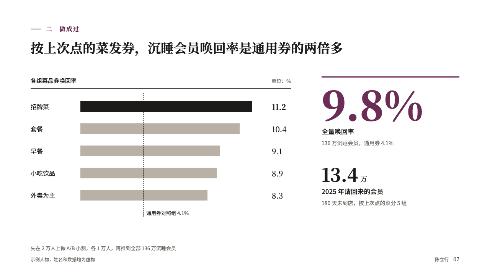
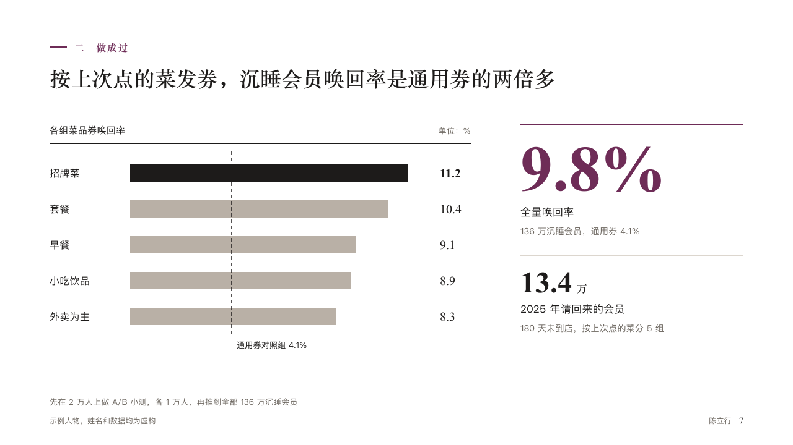

# uplift

What a change did against a control group, as bars on their side beside the result in figures.

Code: [`src/layouts/compositions/uplift.tsx`](../../../src/layouts/compositions/uplift.tsx). The header comment there is the contract. The portrait setting only.

## profile, membership product manager candidacy sample, 2026-10

Settled on p07. The round's decisions are in [rounds/2026-10-12-profile](../../rounds/2026-10-12-profile/README.md).

| board (p07) | engine |
| :-: | :-: |
|  |  |

**What it looks like.** At the left the chart's title and its unit in the grey over a hairline of the ink, a bar a row with its category at the left and its value in the serif in one column after the bars. The marked bar is in the ink, the rest in the warm grey, and the control is a dashed line down all the rows, named under them. At the right the result: the first figure under a 3px rule of the accent at 104px, in the accent when marked, its label and note under it, a second figure at 48px under a pale hairline.

**Why.** A win-back rate means little alone. Against the control it reads as a multiple, and the one figure at the right says what it came to.

**What it gave up.**

- Takes a horizontal `bar` chart of one series of two to eight points, with or without a reference, and a `kpi_cards` of one or two.
- A category wider than 200px, a second series, negative values or a figure too wide for its column sends the page back.
