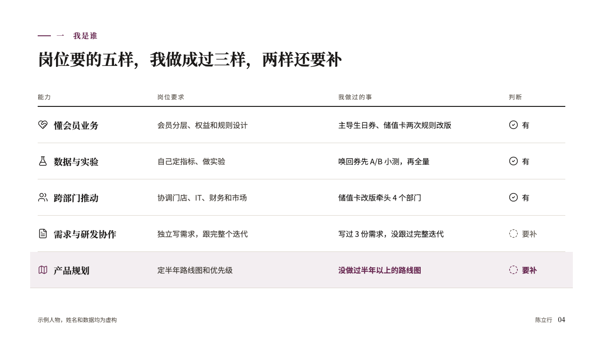
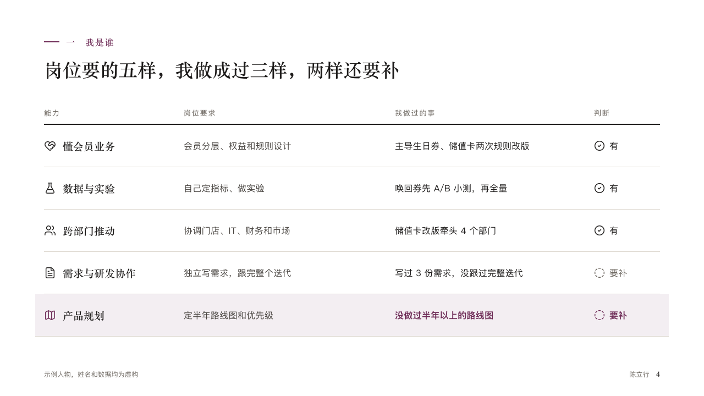

# verdicts

What a role asks for against what the speaker has done, with a verdict a row.

Code: [`src/layouts/compositions/verdicts.tsx`](../../../src/layouts/compositions/verdicts.tsx). The header comment there is the contract. The portrait setting only.

## profile, membership product manager candidacy sample, 2026-10

Settled on p04. The round's decisions are in [rounds/2026-10-12-profile](../../rounds/2026-10-12-profile/README.md).

| board (p04) | engine |
| :-: | :-: |
|  |  |

**What it looks like.** An open table across the measure: a header of small grey words tracked wide over a 2px rule of the ink, then a row each 76px tall under a pale hairline. In a row: its icon and its label bold in the serif, what the role asks a step quieter, what the speaker has done in the ink, and the verdict after a symbol for its kind of news (a ringed tick for `success`, a dashed ring for `warning`, a ringed cross for `danger`). The row the page is about sits on a pale tint of the accent, its icon, verdict and marked words in the accent.

**Why.** Saying which asks are met and which are not, before anyone asks, is what makes the rest of the talk believable.

**What it gave up.**

- Takes a `comparison` of one or two columns and two to six rows, every row tagged.
- A title, a recommended column, a cell past two lines or a label past one line sends the page back.
