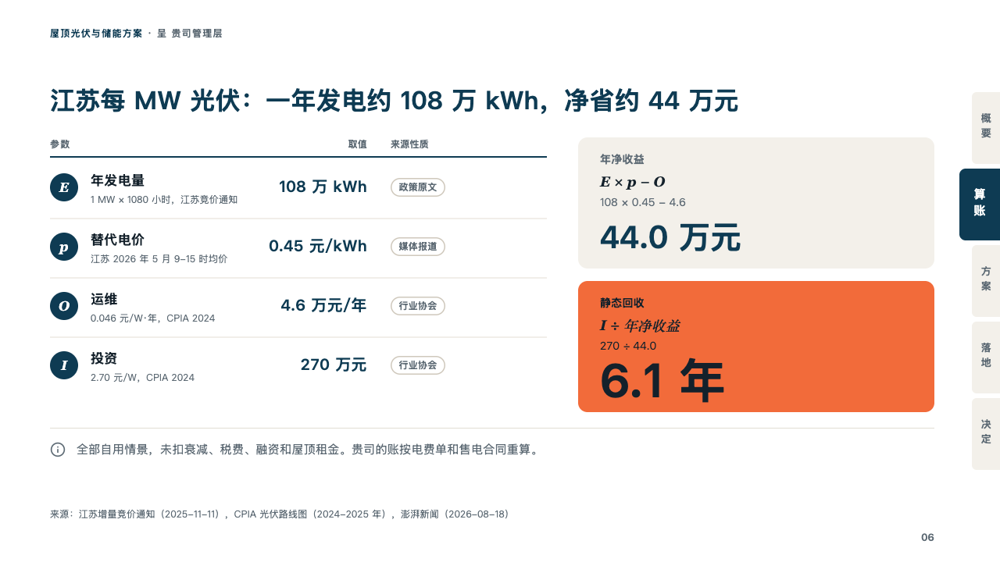
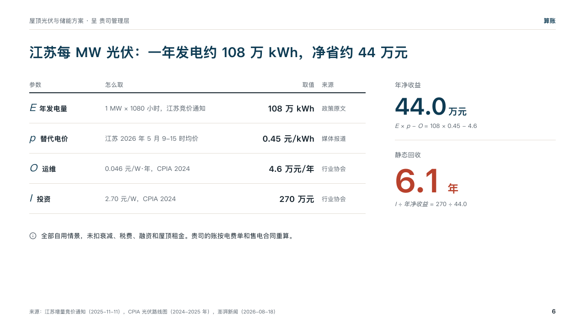

# workings

A sum worked out on one page: its inputs, its working and its answer.

Code: [`src/layouts/compositions/workings.tsx`](../../../src/layouts/compositions/workings.tsx). The header comment there is the contract. The binder setting only.

## proposal, rooftop solar and storage proposal sample, 2026-10

Settled on the per-MW sum page (p06), the page a proposal is judged on. The round's decisions are in [rounds/2026-10-06-proposal](../../rounds/2026-10-06-proposal/README.md).

| board (p06) | engine |
| :-: | :-: |
|  |  |

The board in the table is the first round's. The print round redrew this page in a design tool outside this folder, and the engine render shows the page as it is set now.

**What it looks like.** At the left the inputs as a ruled table: the column headers in small grey over a 2px rule of the ink, a row an input under a hairline, its symbol in italic petrol before its name bold (「E」, 「p」, 「O」, 「I」), how it is reached in grey, its value bold to the right, and what kind of source it rests on in small grey in a column of its own (「来源」). At the right the working, two figures under each other parted by a hairline: what is worked out in grey, the figure at 52px in petrol with its unit after it, and the formula in italic with the figures put in after " = ". The answer the page lands on under them at 72px in the brick red. Under both, a line after a grey icon saying what the sum leaves out.

**Why.** A finance lead checks a proposal by redoing its sum. Every input with its source and every step of the working on one page lets them do it without asking.

**What it gave up.**

- Takes a `data_table` of four columns (the name, how it is reached with an empty header, the value aligned right, the kind of source) and two to four rows, each name led by a one-letter symbol and a space, a `kpi_cards` of two whose notes are written "formula = figures", the second marked whole, and optionally a `callout` with no title or tag.
- The symbol's space and the " = " are declared on the lines they end, not printed.
- The formula is set in the theme's font in italic. The board set it in Georgia, which the deck does not carry.
- A cell past its column, a formula, figures or result past its column, or a line past one line sends the page back.
