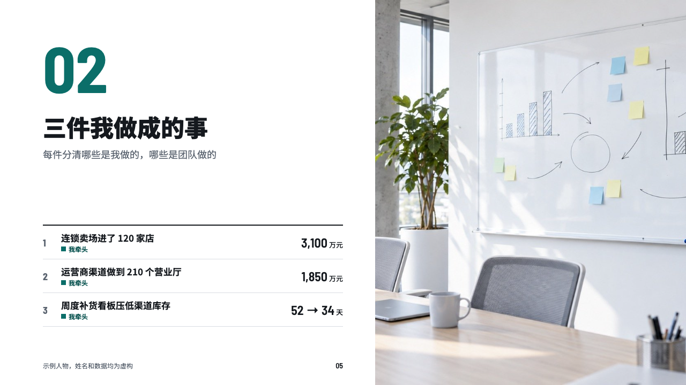
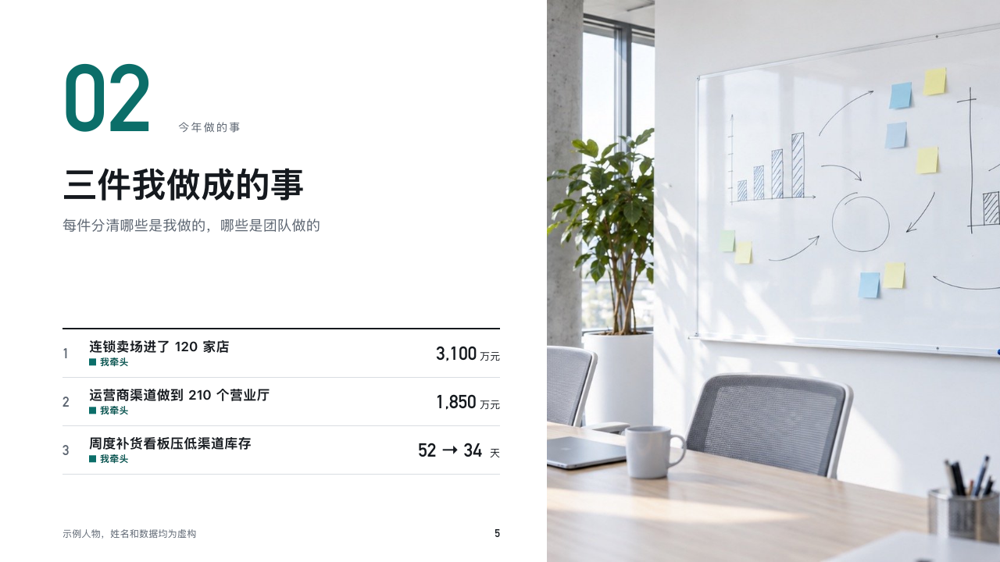

# account-chapter

recap's part divider.

Code: [`src/layouts/chapter-account-chapter.tsx`](../../../src/layouts/chapter-account-chapter.tsx). The header comment there is the contract.

## recap, channel sales year-end review sample, 2026-10

Settled on p05. The round's decisions are in [rounds/2026-10-13-recap](../../rounds/2026-10-13-recap/README.md).

| board (p05) | engine |
| :-: | :-: |
|  |  |

**What it looks like.** The part's number at 120px in the figure face in the accent, and beside it on its baseline the part's name from the course at 14px tracked in the grey. Under them the title at 44px heavy and the subheading. Under a 2px rule what the part covers, a row each with its figure or its state. A photograph bled off the right.

**Why.** A divider that says what is coming and how much rides on it lets the reviewers read the next pages as a set.

**What it gave up.**

- The board drew no part name beside the number. It is drawn so the page's `stage` reaches the page as words, not only as the number.
