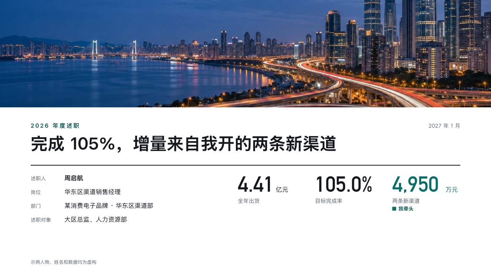

# account-cover

recap's cover.

Code: [`src/layouts/cover-account-cover.tsx`](../../../src/layouts/cover-account-cover.tsx). The header comment there is the contract.

## recap, channel sales year-end review sample, 2026-10

Settled on p01. The round's decisions are in [rounds/2026-10-13-recap](../../rounds/2026-10-13-recap/README.md).

| board (p01) | engine |
| :-: | :-: |
|  |  |

**What it looks like.** A photograph across the top 280px, the occasion tracked in the deep accent and the date under it, the year's conclusion at 44px heavy over a 2px rule, the speaker's particulars as fields at the left and three figures at the right, the one the speaker led in the accent with its legend mark.

**Why.** The reviewers should have the verdict and its three numbers before the first content page.

**What it gave up.**

- A subheading is set under the conclusion at 18px in the grey.
- When the deck owes a classification or a confidentiality mark, the photograph starts at y72 and the mark sits on paper above it.
