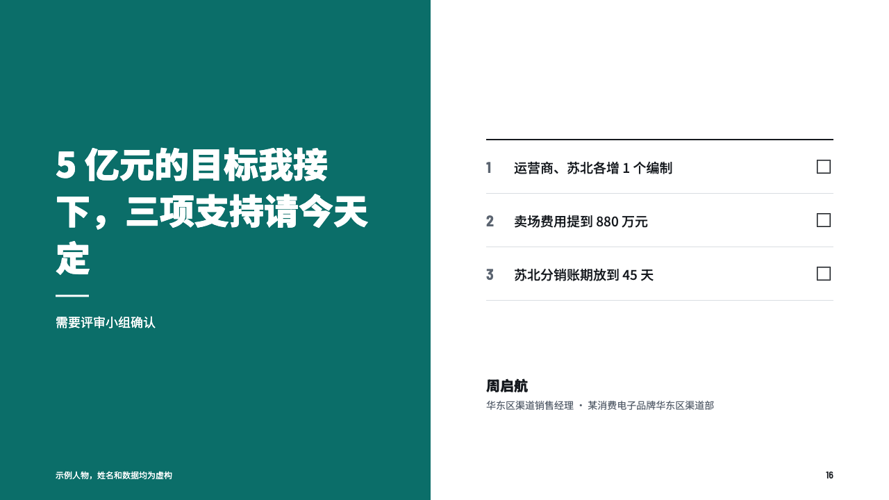
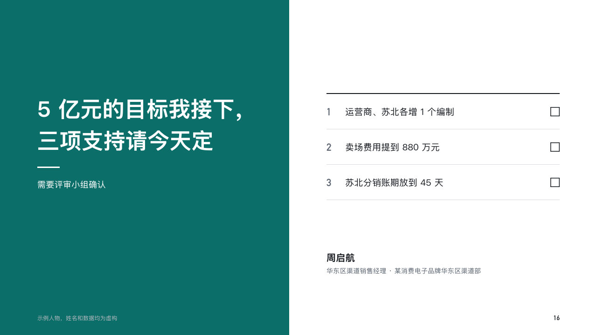

# account-ending

recap's close.

Code: [`src/layouts/ending-account-ending.tsx`](../../../src/layouts/ending-account-ending.tsx). The header comment there is the contract.

## recap, channel sales year-end review sample, 2026-10

Settled on p16. The round's decisions are in [rounds/2026-10-13-recap](../../rounds/2026-10-13-recap/README.md).

| board (p16) | engine |
| :-: | :-: |
|  |  |

**What it looks like.** A block of the accent down the left with the commitment white at 50px heavy, a short rule and a line under it. At the right the asks under a 2px rule, each numbered with an empty box at its end, and the speaker's signature: name, post and department.

**Why.** A review should end on a commitment and the decisions the room takes before it leaves.

**What it gave up.**

- Blank items in the list are not asks and are not numbered.
