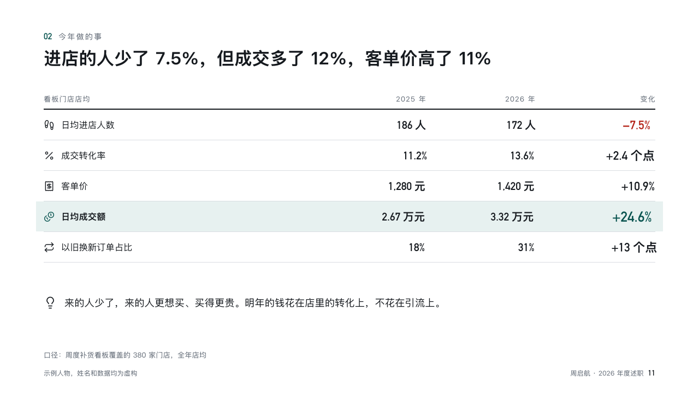

# account-sheet

recap's ordinary content page.

Code: [`src/layouts/content-account-sheet.tsx`](../../../src/layouts/content-account-sheet.tsx). The header comment there is the contract.

## recap, channel sales year-end review sample, 2026-10

Settled on p11. The round's decisions are in [rounds/2026-10-13-recap](../../rounds/2026-10-13-recap/README.md).

| board (p11) | engine |
| :-: | :-: |
|  |  |

**What it looks like.** The numbered section line at y72 (「02 今年做的事」), the claim heavy at 32/45 from y84, and the body handed to a composition in the account setting. A page none of them takes is drawn by the component renderer under the same section line and claim.

**Why.** Every page answers one of the three questions a reviewer asks, so every page opens the same way.

**What it gave up.**

- A page with a subheading goes to the component renderer, which sets it under the claim.
