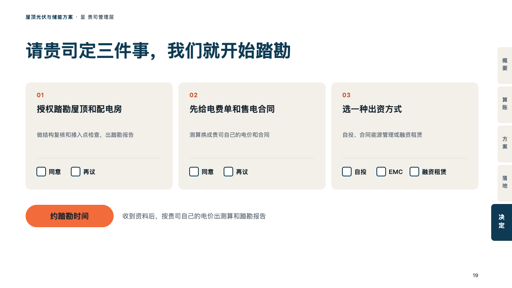
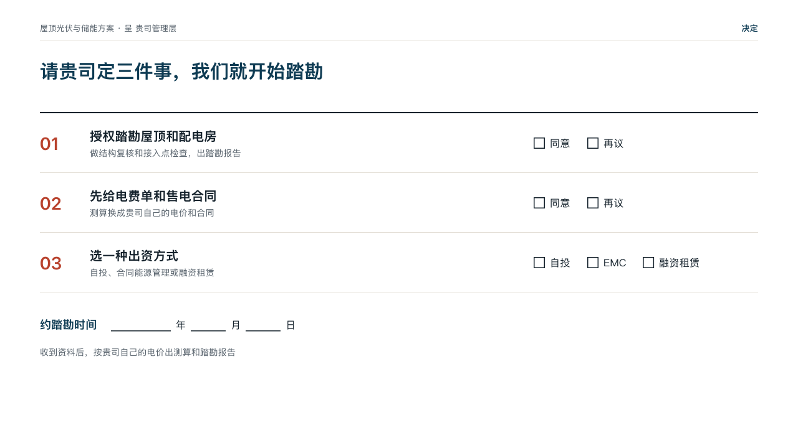

# binder-ending

proposal's close: the decisions the client is asked to make, each a ruled row with its own boxes to tick, and a line to fill in for the next step.

Code: [`src/layouts/ending-binder-ending.tsx`](../../../src/layouts/ending-binder-ending.tsx).

## proposal, rooftop solar and storage proposal sample, 2026-10

Settled on p19. The round's decisions are in [rounds/2026-10-06-proposal](../../rounds/2026-10-06-proposal/README.md).

| board (p19) | engine |
| :-: | :-: |
|  |  |

The board in the table is the first round's. The print round redrew this page in a design tool outside this folder, and the engine render shows the page as it is set now.

**What it looks like.** The running head as on a content page: the page's `kicker` (the deck's label) at the left at 13px in the grey, the page's section at the right in petrol bold, a hairline under both. The closing line at 30/42 bold in petrol, on one line whenever it fits. Under it the page's `numbered_cards`, two to four decisions, a ruled row each under a 2px ink rule with hairlines between: its number in two digits at 28px bold in the brick red (「01」), the decision at 20px bold with a line on it at 14px in the grey, and at the right an empty square box, 18px with a 1.5px ink outline, for each choice of the page's `ballot` (「同意」, 「再议」), or the item's own choices where `ballot.item_choices` gives it some (「自投」, 「EMC」, 「融资租赁」), each at 16px. Under the rows the page's `paragraph` as a line to fill in: the words before the first blank at 18px bold in petrol, each run of 「＿」 (two or more) a line to write on, the words between at 16px in the ink (「约踏勘时间 ＿＿＿ 年 ＿＿ 月 ＿＿ 日」). A paragraph with no blanks gets one line after its words. The subheading under it at 14px in the grey.

**Why.** A proposal ends on what the client decides. A box per choice makes the decision a mark on the paper, and the line to fill in is the next step in the author's own words, set the way a printed form asks for it.

**What it gave up.**

- No line to fill in without a `paragraph`: the face never writes its own words for it.
- A ballot whose `item_choices` names a decision the page does not have, or a signature line, is declared dropped.
- No motif and no folio. The board printed 「19」 at the foot.
