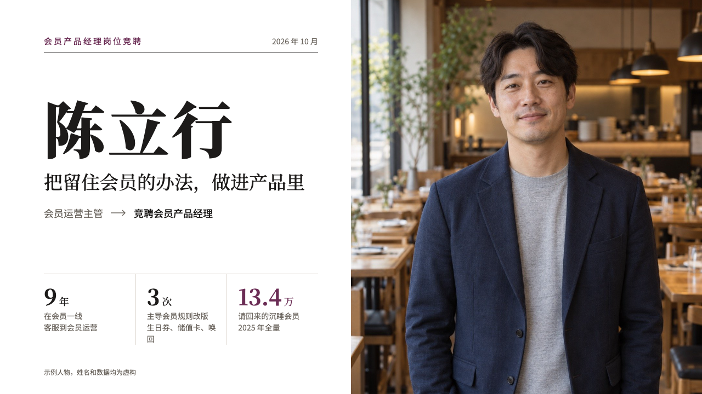
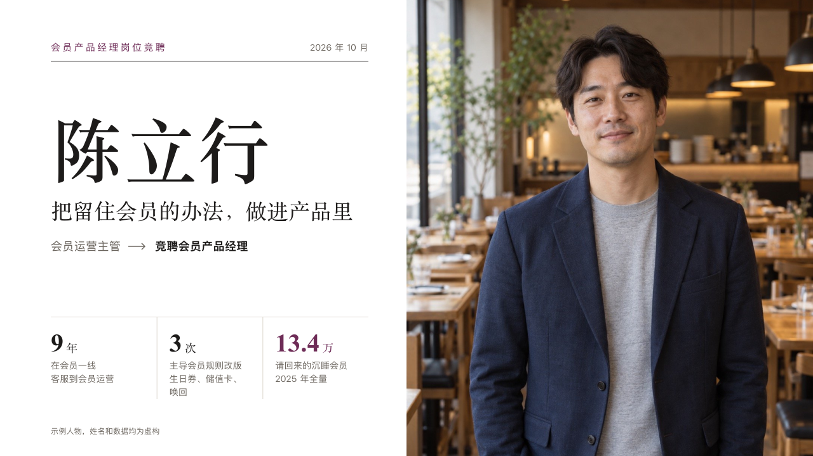

# portrait-cover

profile's cover: the speaker's name set huge beside their portrait.

Code: [`src/layouts/cover-portrait-cover.tsx`](../../../src/layouts/cover-portrait-cover.tsx).

## profile, membership product manager candidacy sample, 2026-10

Settled on p01. The round's decisions are in [rounds/2026-10-12-profile](../../rounds/2026-10-12-profile/README.md).

| board (p01) | engine |
| :-: | :-: |
|  |  |

**What it looks like.** The portrait runs down the right half from x640. At the left: the occasion (the page's `kicker`) in the accent tracked wide with the date at the right, a hairline, the speaker's name (the deck's first author) bold in the serif at 112px, stepping down to 72px when it is long, the claim in the serif at 34px, then the post held (the author's `role`), an arrow and the post wanted (`subheading`). Under a pale hairline three figures from `kpi_cards` with hairlines between them, the last in the accent. The deck's label and the photograph's credit at the bottom left.

**Why.** The panel should know whose talk it is and what they are asking for before a word is said.

**What it gave up.**

- Figures with only a value, a unit, a label and a note. A fourth figure, an icon, a delta, a tag, a tone or a source declares them dropped.
- No page number and no section line.
- A role row too long for one line puts the arrow and the post wanted on a second line.
