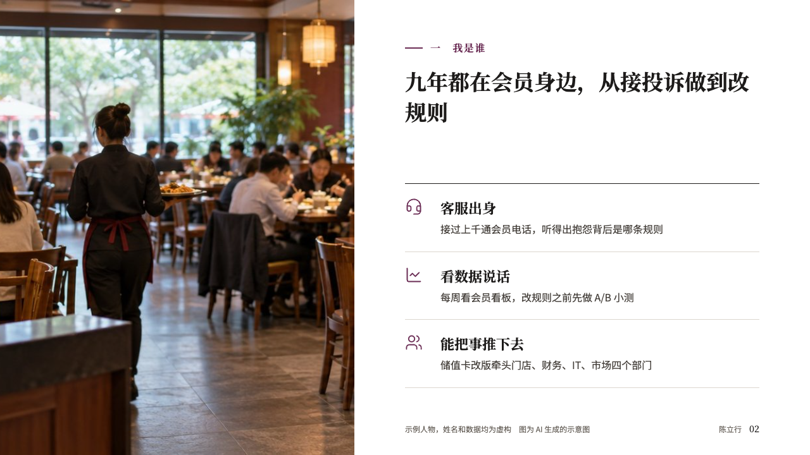
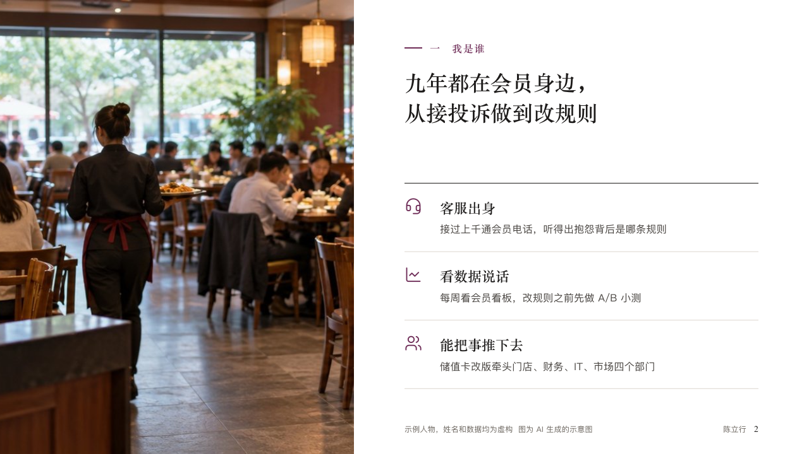

# portrait-sheet

profile's ordinary content page: the section line, the claim, and the body handed to the compositions in the portrait setting.

Code: [`src/layouts/content-portrait-sheet.tsx`](../../../src/layouts/content-portrait-sheet.tsx).

## profile, membership product manager candidacy sample, 2026-10

Settled on every content page of the board. The round's decisions are in [rounds/2026-10-12-profile](../../rounds/2026-10-12-profile/README.md).

| board (p02) | engine |
| :-: | :-: |
|  |  |

**What it looks like.** From y64 at the left, the section line: a 28px rule of the accent and the part of the talk (「一　我是谁」) at 16px in the accent. Under it the claim bold in the serif at 34/48 across the measure, at most two lines. The body is one of the ten compositions in the portrait setting, which place the section line, the claim and the credit themselves. A page none of them takes is drawn by the component renderer under the same section line and claim. The footer row is the motif's.

**Why.** A short talk is followed by its parts. The section line tells the panel where they are without a progress bar or a header.

**What it gave up.**

- Every content kind the menu offers goes to this face, so a page none of the compositions takes looks plainer than the board's.
- A `paragraph` may share the page with a full-body component (`fullBodyCompanions`), as the self-assessment does.
