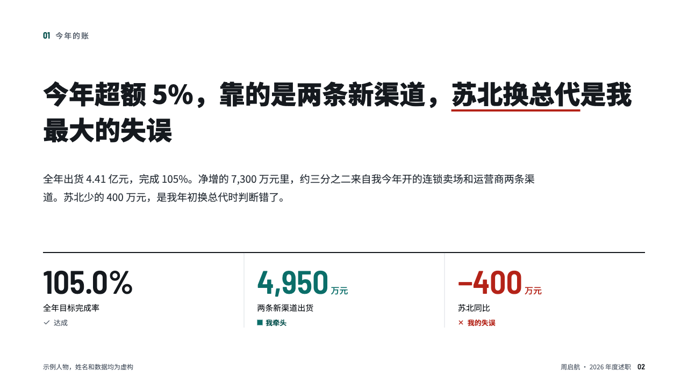
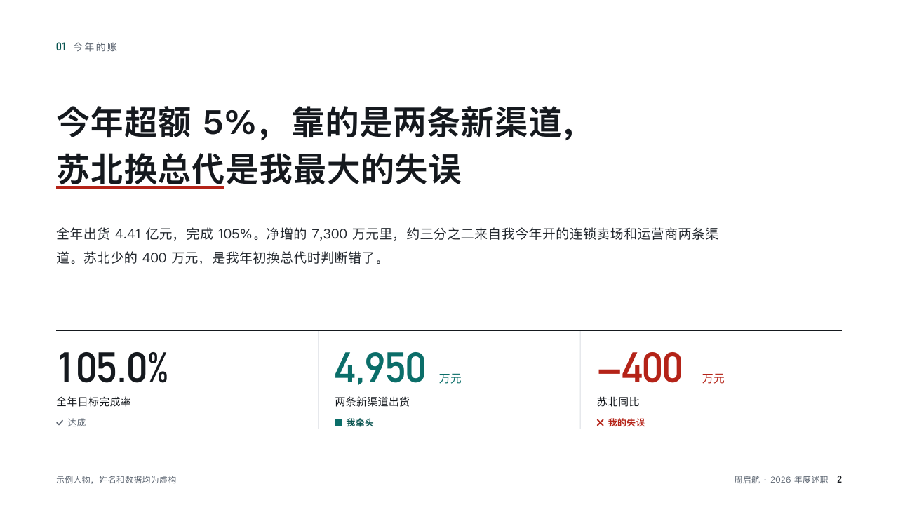

# recap-motif

recap's footer row: the deck's label, the speaker and the occasion, and the page number.

Code: [`src/motifs/motif-recap-motif.tsx`](../../../src/motifs/motif-recap-motif.tsx).

## recap, channel sales year-end review sample, 2026-10

Settled on p02. The round's decisions are in [rounds/2026-10-13-recap](../../rounds/2026-10-13-recap/README.md).

| board (p02) | engine |
| :-: | :-: |
|  |  |

**What it looks like.** On content pages at y688: at the left the deck's label at 12px in the grey, at the right the speaker and the occasion (「周启航 · 2026 年度述职」) at 12px in the grey and the page number at 14px in the figure face in the ink. No line and no box. A face that bleeds a photograph writes `data-frame-left` or `data-frame-right`, and the row keeps to the column left.

**Why.** A printed page should say whose review it came from and that the person and figures are invented, wherever it ends up.

**What it gave up.**

- The number is 「2」, not 「02」: a slide-number field cannot be padded.
- Nothing on the cover, the chapters and the close, whose faces draw their own footer row.
